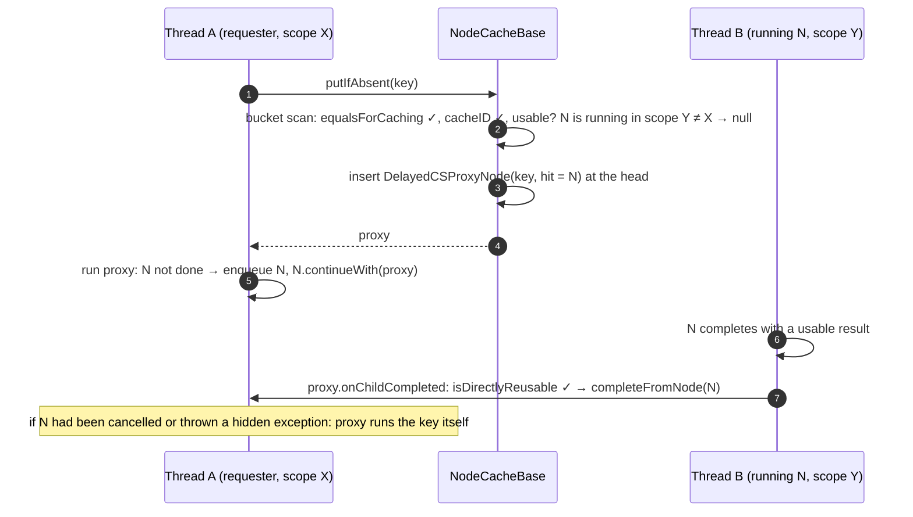
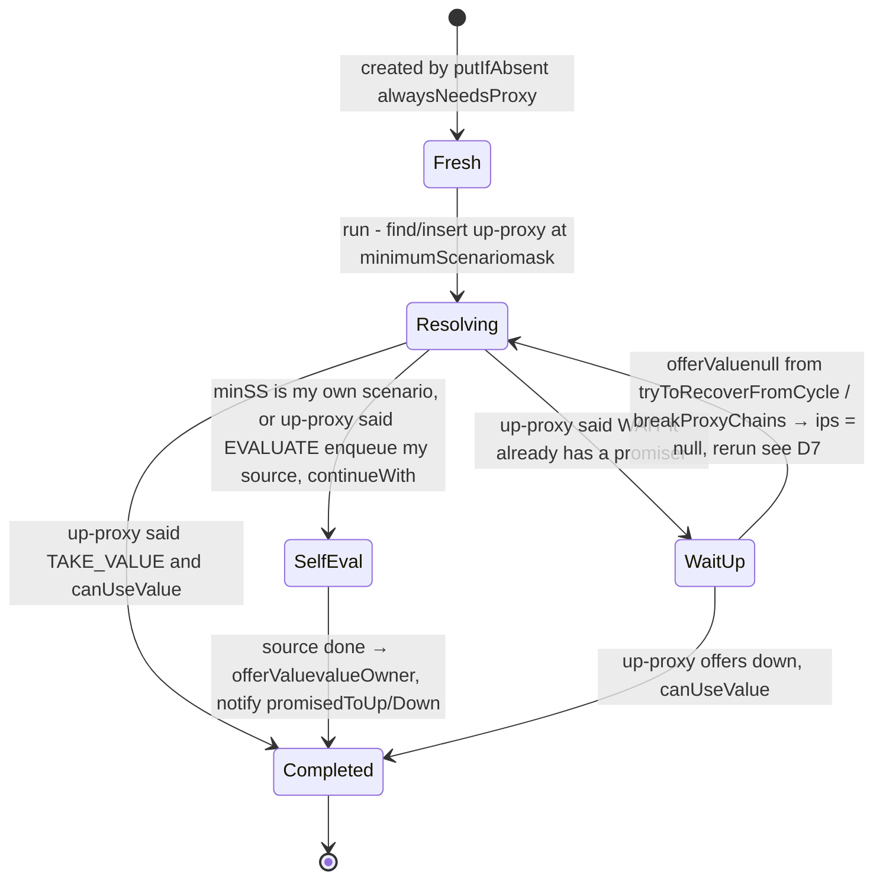
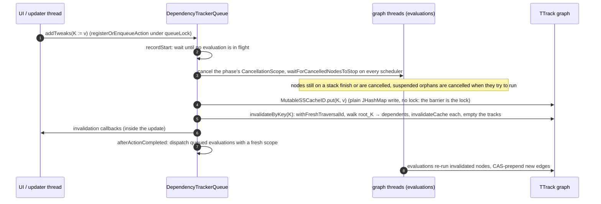

# A field guide to cirrus caching and dependency tracking

Second guide, for the layer above the scheduler ([FIELD_GUIDE.md](FIELD_GUIDE.md)). Same shape: what each piece is, the nearest well-known system, where cirrus differs (both ways), distilled commented code, a diagram where the mechanism needs one, and what a reviewer should look at. Pointers like "see D7" go to [CACHE_REVIEW.md](CACHE_REVIEW.md); this document does not restate findings.

Paths are under `optimus/platform/projects/core/src/main/scala/optimus/`.

## 1. The problem in one paragraph

A `@node` is a pure function of its entity, its arguments, and the *tweakables* it reads. A tweakable is a property whose value can be overridden by a *tweak* in a *scenario*; scenarios nest into a *scenario stack*. Memoising a node therefore means keying on (entity, args, "which tweaks were in effect"), and invalidating means knowing, for every cached node, which tweakables it read, transitively. Cirrus solves the first with a shared `SSCacheID` per distinct tweak set (§3), the second with a lock-free dependency graph (§6), and squeezes extra reuse out of nodes whose dependencies are a *subset* of the stack's tweaks (§5). Everything else is plumbing.

**Parallels.** Memoisation under dynamic scoping (Lisp special variables, React context, Scala `DynamicVariable`): the scenario stack *is* the dynamic environment. Incremental computation frameworks (Adapton, Salsa, Jane Street Incremental, Bazel/Skyframe): a dependency graph of memoised computations with dirtying on input change. Cirrus differs from all of them by letting many environments coexist and by sharing results across environments that agree on the inputs a node actually used.

## 2. The node as cache key: `PropertyNode` and `NodeTaskInfo`

`PropertyNode[T]` (graph/PropertyNode.scala) is a `NodeTask` (see the scheduler guide §1) that is also a `NodeKey`: it carries `entity`, `args`, `argsHash`/`argsEquals`, and a singleton `propertyInfo: NodeTaskInfo` per property. The plugin generates one subclass per `@node`; the probes hand-write them. `NodeTaskInfo` is a process-wide registry entry: cache policy, custom cache, tweakable bit (§5), "was tweaked" flags that short-circuit lookups, and the `DONT_CACHE`/`SCENARIOINDEPENDENT`/`TWEAKABLE`/`DONT_TRACK_FOR_INVALIDATION` flags that decide which of the mechanisms below apply.

```java
// NodeCacheBase.putIfAbsent, distilled: the whole lookup in one place.
public final <T> PropertyNode<T> putIfAbsent(NCPolicy policy0, PropertyNode<T> key, EvaluationQueue eq) {
  var policy = policy0.switchPolicy(key);                      // e.g. XSFT -> Basic under a tracking scenario
  if (policy.noCache) return key;
  if (policy.tryLocalCache(key)) {                             // per-entity single slot; see D9
    PropertyNode<T> local = policy.localMatch(key);
    if (local != null) return local;
  }
  PropertyNode<T> r = putIfAbsentCore(policy, key, eq);        // hash table, §4
  if (policy.tryLocalCache(key)) EntityImpl.setLocalCache(r.entity(), r);
  return r;
}

// The scenario part of the key. NCPolicy.matchesScenario, default:
<T> boolean matchesScenario(PropertyNode<T> cached, PropertyNode<T> key) {
  return key.scenarioStack()._cacheID() == cached.scenarioStack()._cacheID();   // identity of the shared cache id
}
<T> int hashOf(PropertyNode<T> key) { return chash(key.hashCodeForCaching(), key.scenarioStack()); }  // key hash ^ cacheID.hashCode

// And the part that is not the key: cancel scope and runtime environment, decided per lookup (NCSupport).
static PropertyNode<?> isUsableWRTCancelScopeAndEnv(PropertyNode<?> key, PropertyNode<?> cached) {
  if (keySS.cancelScopeAndEnvId() == cachedSS.cancelScopeAndEnvId()) return cached;   // packed long, checked on overflow
  if (cached.isDoneWithUsableResult()) return sameEnv || !cached.accessedRuntimeEnv() ? cached : key;
  if (sameCS) ...;                                              // three-valued: cached (use), key (recompute), null (not yet: proxy)
  if (cachedSS.cancelScope().isCancelled() || cached.isDoneWithExceptionToHide()) return key;
  return null;
}
```

**Parallels.** Guava `LoadingCache`/Caffeine keyed on a composite key; Haskell's lazy thunks (a node is a thunk that memoises itself); GHC "blackholing" (adopting a thunk another thread is already evaluating is what a `DelayedCSProxyNode` does).

**What to check.** `equalsForCaching` is deliberately asymmetric (proxies compare equal to their templates, not vice versa); the hash is cached on the node (`$hashCodeArgsAndInfo`) so a mutable arg silently corrupts lookups; the "usable" predicate's `null` means "not yet", and callers must not treat it as "yes" (see xsft notes). Everything the plugin guarantees (fresh key per lookup, tracking-value flag for tweakables) is assert-only at runtime.

## 3. Scenario stacks and the shared cache id

`ScenarioStack` (platform/ScenarioStack.scala) is an immutable case class: parent pointer, the scenario at this level, flags, `tweakableListener` (§6), `siParams` (cancel scope, plugin tags, scheduler), and `_cacheID: SSCacheID`. `createChild(scenario)` expands the scenario's tweaks, builds an `SSCacheKey(parent._cacheID.id, expandedScenario)` and interns it in `CacheIDs.global` (a `ConcurrentHashMap` of weak references), so two stacks under the same parent with equal scenarios get the *same* `SSCacheID` object and therefore share every cached node. The cache id holds the resolved tweak map (instance tweaks by key, property tweaks by info), a `tweakMask` (the OR of tweaked properties' bits, §5), and a lazily built hash of tweaked keys for XS.

```mermaid
stateDiagram-v2
    direction LR
    root: root stack<br/>cacheID #1 (unique)
    a1: given(S) #1<br/>cacheID #7
    a2: given(S) #2<br/>cacheID #7 (shared)
    b: given(S') <br/>cacheID #8
    si: SI stack<br/>copy of root, cacheID #1
    trk: tracking scenario<br/>MutableSSCacheID, mutated in place
    [*] --> root
    root --> a1: createChildS interns SSCacheKey1, S
    root --> a2: createChildS again, hit in CacheIDs.global
    root --> b: createChildS', new key
    root --> si: ssShared.siStack see D4
    root --> trk: DependencyTracker §6
```

Tweak resolution for a tweakable property walks the stack from the top: at each level `cacheID.mayContainTweak(info)` (mask test, false positives only) then `cacheID.get(key)` / `get(info)`; `when`-predicated tweaks evaluate their predicate as a node, so resolution itself is asynchronous (`TwkResolver` is a `PropertyNode` that suspends). By-name tweaks produce a `TweakNode` evaluated in the stack where the tweak was found (or where `bind`/`bindOnce` say).

```scala
// platform/ScenarioStack.scala createChildInternal, distilled.
val cacheKey    = new SSCacheKey(_cacheID.id, expandedScenario)      // parent id + flat scenario; NOT plugin tags, listener, flags
val cacheID     = CacheIDs.putIfAbsent(cacheKey, SSCacheID.newUninitialized(expandedScenario))
initChild(scenario, frozen, extraFlags, tl, cacheID, name)           // a copy with the shared id and this stack's own listener/tags

// graph/CacheIDs.scala: intern with weak values, reuse a dead key's slot in place.
global.compute(key, (_, oldRef) =>
  if (oldRef ne null && oldRef.get ne null) { cacheID = oldRef.get; oldRef }     // hit
  else { val ref = new SSCacheIDRef(oldRef?.key ?? key, cacheID, queue); (that key).updateKeyWithValue(ref, cacheID); ref })
cacheID.ensureInitialized()                                          // resolves the tweak map once, under the id's own lock
```

**Parallels.** Hash-consing / interning of environments (the same trick as `Interner`s for ASTs); persistent data structures with structural sharing; MVCC snapshots in databases (a stack is a snapshot; a tracking scenario is the one mutable "current" version).

**Where it differs.** The key deliberately omits plugin tags, node inputs, the listener and most flags, on the contract that none of them affect node results (`PluginTagKey.affectsNodeResult = false`). That is a strong assumption with no runtime check (F8). The SI stack is a copy sharing the root's id (D4). Tracking scenarios use a *mutable* cache id so tweak updates do not rebuild stacks; that trades immutability for the queue invariant in §6.

**What to check.** Any `copy(...)` that changes something the cache should know about without a new `_cacheID`; equality of `Tweak`/`Scenario` (what it ignores, F1, D13, F7); the double-checked `_stableSS` and `withCacheableTransitively` (F3); anything that reads `siParams` from inside a cacheable node.

## 4. The node cache: a CAS-only hash table with a ledger-batched LRU

`NodeCacheBase` (graph/cache/NodeCacheBase.java): `volatile NCEntry[] table`, per-bucket singly linked list, insert by CAS at the head, *no remove in the table*: entries go invalid when their node is `isInvalidCache` or the value is nulled, and are unlinked later under the LRU lock. `NodeCacheWithLRU` adds `ledgers[cacheConcurrency]`, per-thread-ish staging arrays; a hit appends to a ledger under that ledger's monitor; when a ledger fills, the toucher takes `updateLock`, replays every ledger into the doubly linked LRU (`catchupCore`), evicts overflow, and unlinks invalid entries.

```java
// NodeCacheBase.putIfAbsentCore, distilled: CHM-v7 bucket protocol with proxies.
int hash = policy.hashOf(key); NCEntry[] t = table; int i = offset(t, hash); NCEntry tail = null;
while (true) {
  NCEntry head = (NCEntry) vh_table.getVolatile(t, i);
  if (head == tombstone) { foundTombstone(); t = table; i = offset(t, hash); tail = null; continue; }   // scoped cache resize
  PropertyNode<T> insert = key;
  PropertyNode<T> found = getIfPresentCore(l, head, tail, key, policy, hash, eq);   // equalsForCaching, matchesScenario, usability
  if (found != null) {
    PropertyNode<?> kvn = NCSupport.isUsableWRTCancelScopeAndEnv(key, found);
    if (kvn == found) return found;                                   // reuse
    if (kvn == null) insert = proxy = policy.updateProxy(this, key, found, proxy);   // "not yet": insert a proxy that waits on found
  }
  if (policy.alwaysNeedsProxy) insert = proxy = policy.updateProxy(this, key, found != null ? found : alternative, proxy);   // XSFT
  NCEntry ne = newNCEntry(hash, insert, head, grouped);
  if (vh_table.compareAndSet(t, i, head, ne)) { newEntryAdded(l, ne); return insert; }
  tail = head;                                                        // lost the race: rescan only what was added since
}

// NodeCacheWithLRU.touchEntry, distilled: the ledger trick.
synchronized (l) { entry.inLedger = true; if (l.count == l.records.length) needCatchup = true;
                   else if (l.count >= batch && updateLock.tryLock()) needCatchup = hasLock = true;
                   else l.records[l.count++] = entry; }
if (needCatchup) { if (!hasLock) updateLock.lock(); try { catchupCore(); catchupEntry(entry); removeOverflow(); } finally { updateLock.unlock(); } }
```



**Parallels.** `ConcurrentHashMap` (JDK 7 segments, JDK 8 bins); the "no remove, mark invalid" idea is like tombstoning in open addressing; the ledger is a sampled/approximate LRU in the spirit of Caffeine's striped buffers (Caffeine uses W-TinyLFU plus read buffers; cirrus uses plain LRU plus write-through ledgers); CHM's "rescan only the new prefix" is the standard lock-free insert.

**Where it differs.** Semantics are explicitly at-least-once: resize, concurrent unlink and ledger lag can all produce a miss, and that is fine because `tryRun` guards execution and values are RT. The cost is duplicate work, never a wrong value. Resize of the LRU cache (`setMaxSize`) is acknowledged as racy (OPTIMUS-57931); the scoped cache resizes with tombstones instead. Proxies are inserted *into the table* as stand-ins, which is unusual: the cache stores promises.

**What to check.** Plain fields with "volatile" comments (R16); every reader of `size()` that treats it as a count; what `getIfPresentCore` does on a tentative hit (keeps scanning, P4); `clear` and `setMaxSize` under concurrent inserts (W4).

## 5. Cross-scenario reuse: XS and XSFT

Two policies squeeze more reuse out of the cache than "same cache id":

- **XS** records, per node, exactly which tweaks and tweakables it observed (`RecordingTweakableListener`, frozen into `RecordedTweakables` at completion). A request under another scenario matches the recording against its own stack (`matchXscenario`): every recorded tweak must resolve to an `equals` tweak, every recorded untweaked tweakable must still be untweaked. Sound if nodes are pure in their recorded inputs.
- **XSFT** keeps no per-node recording. Each tweakable *property* gets a bit (`NodeTaskInfo.tweakMask`, assigned lazily under a class-wide lock; hierarchies share bits); each scenario's cache id ORs the bits of what it tweaks; each *node* accumulates the bits of what it read (`_tpd`, merged in `combineInfo`); each property accumulates, over all its completed nodes, the union `dependsOnTweakMask`. A request under stack S walks up to the highest ancestor whose scenarios do not intersect the property mask (`minimumScenario`) and shares a value there, through a chain of proxies that promise values up and down.

```java
// TPDMask: 2 qwords in source, rewritten to tweakUsageQWords (default 6) by the entity agent. Bits fold modulo width.
public boolean intersects(TPDMask m) { return (m0 & m.m0) != 0 || (m1 & m.m1) != 0; }
public boolean subsetOf(TPDMask m)   { return (m0 | m.m0) == m.m0 && (m1 | m.m1) == m.m1; }

// NodeTaskInfo.updateDependsOnMask: monotone, copy-on-write, identity change = "mask grew".
if (getCacheable() && !node.isTweakPropertyDependencySubsetOf(dependsOnTweakMask))
  synchronized (this) { TPDMask n = new TPDMask(); n.merge(dependsOnTweakMask); node.mergeTweakPropertyDependenciesInto(n); dependsOnTweakMask = n; }

// DelayedXSFTProxyNode.canUseValue, distilled: the soundness argument.
if (ips.dependsOnMask == info.dependsOnTweakMask()) return true;       // fast path: mask unchanged since minSS was chosen, so value._tpd ⊆ mask
for (ss = from; ss != to && !ss.isRoot; ss = ss.parent)                // slow path: no tweak between here and there intersects what the value read
  if (ss._cacheID().mayContainTweak(value._tpd)) return false;
return true;                                                           // NB: also true if `to` was never reached (see D7)
```



**Parallels.** XS is memoisation with *exact* dependency recording (Adapton's demanded computation graph, Salsa's "verify-memoized" with per-input revisions). XSFT is a Bloom-filter-style over-approximation of dependencies (the bit per property, folded on overflow) in the spirit of Skyframe's "dirty if any dep changed" but made cheaper and sound-by-widening: a too-small property mask causes retries, not wrong values, because widening happens before the value becomes visible and the fast path tests mask identity. The up/down promise chain resembles a lattice of memo tables indexed by environment prefix.

**Where it differs.** Cirrus's version is more aggressive than any of the named systems: it will reuse a value computed under a *different* environment as soon as the two agree on the recorded or masked inputs, and it does so concurrently with proxies that complete one another. The soundness argument rests on three things that are easy to break: masks only grow (D10 breaks it from config), a value's mask is always a subset of the property mask when seen (D8 breaks it with width 0, D3 with truncated config masks), and a proxy only receives offers from the up-proxy it chose (D7 breaks it after a reset, D16 kills the process afterwards). XS additionally assumes a recording is never mutated after freezing (D1 breaks it).

**What to check.** Every write to `dependsOnTweakMask` that is not a merge; every path that resets a proxy's `ips` without removing it from the old up-proxy's lists; every `replace(scenarioStack)` on a node other threads can see; `fromArray` vs `indexListToMask` (fold vs truncate); the `tweakUsageQWords=0` mode.

## 6. Dependency tracking: a lock-free graph and a queue that owns the clock

A `DependencyTracker` (graph/tracking/) is a mutable scenario: a `MutableSSCacheID` of tweaks, two scenario stacks (normal and non-cacheable) that share it, a `TweakableTracker` per level, and a `DependencyTrackerQueue` that serialises *updates* (tweak changes) against *evaluations*. When a cacheable node completes under a tracking stack, `onTweakableNodeCompleted` records an edge from each tweakable it read (a `TTrack` root per tweakable key) to the node's own `TTrack`, with CAS-prepend on the callee's caller list and a weak reference to the node. When a tweak changes, `TweakableTracker.invalidate` walks from the root track to every dependent, `invalidateCache`s the nodes (clear `DONE_FLAG`, set `INVALID_CACHE`), and empties the tracks. Cleanup (`CleanupVisitor`) prunes cleared refs and redundant edges on a timer or when a watermark of cleared refs is crossed.



```java
// TTrack.nodeCompleted, distilled: the only hot-path write.
do { initial = nodes; if (initial == Invalid) ...prepend anyway (see D6)...; next = new TTrackRef(node, initial, refQ); }
while (!nodes_h.compareAndSet(this, initial, next));

// DependencyTrackerQueue, distilled: reader/writer exclusion built from a work queue.
recordStart(action):  if (action.isUpdate) require(inFlight == 0) else require(!updating)
evaluationBarrier():  scope.cancelInternal(...); Scheduler.schedulers.foreach(_.waitForCancelledNodesToStop(scope)); scope = null
scheduleAction(a):    a.beforeAction(); a.executeAsync { afterAction(); raiseCallback(); afterActionCompleted(a) }   // no finally (see R1)
```

**Parallels.** MobX/Vue reactive dependency tracking (observers register during evaluation, invalidation walks observers); Skyframe's dirtying with version numbers (the traversal id is a mark-and-sweep epoch); Salsa's "revision" counter; the queue is a reader/writer lock with cancellation as the fence, like a stop-the-world safepoint for one tracker.

**Where it differs.** The graph has *no synchronisation of its own* against invalidation or cleanup: graph threads CAS, the updater plain-stores, and correctness rests entirely on the queue's guarantee that no node writing to the graph is running during an update. That is a strong, simple design (W10, W11) with a sharp edge: every path that evaluates outside the queue's scope, or lets an orphan resume during an update, produces a *silent* stale node (D6, D15). The traversal id is per root but updates run per queue (D2). Cleanup can take the queue lock from inside a node's `complete()` (R3). Nothing here fails loudly; the review's main recommendation for this ring is a sentinel check in `nodeCompleted`.

**What to check.** Every entry point that evaluates under a tracker's stack: does it get its cancel scope from the queue? Every place `queueLock` is held while waiting or calling out. Every mutation of `traversalId`. What `invalidateCache` leaves a node in (`INVALID_CACHE | NOT_RUNNABLE`, no `DONE_FLAG`), and who can observe that state (`isDoneEx` is true, `isDone` is false).

## 7. Proxies, promises and cancellation scopes

Three kinds of stand-in live in the cache: `DelayedCSProxyNode` (same cache id, different cancel scope: wait and see whether the running node's result is usable), `DelayedXSProxyNode` (find or become the XS owner, match recordings), `DelayedXSFTProxyNode` (the promise chain of §5). All are `PropertyNode`s, so they key, hash, wait and notify like any node, and all complete by `completeFromNode(hit)`, copying the result. Cancellation scopes (graph/CancellationScope.scala) are a tree; a node's scope is in its stack's `siParams`; usability of a cached node across scopes is decided by `isUsableWRTCancelScopeAndEnv` (§2); the tracker uses a fresh child scope per phase as its barrier (§6).

**Parallels.** Promise/future chaining; "read-your-writes" through a proxy; Go's context tree for cancellation.

**What to check.** `cancelInsteadOfRun` on each proxy type (what it scrubs, D1); `replace(scenarioStack)` calls (they re-home a node another thread may be matching); the `delayOnChildCompleted` trampoline for long proxy chains; how many proxies a single key can accumulate under cancel-scope churn (T19).

## 8. Settings that change the semantics

`optimus.profile.enableXSFT` (default true: ordinary cacheable nodes get XSFT proxies); `optimus.graph.tweakUsageQWords` (6; 0 disables per-node masks but not the policy, D8); `optimus.graph.tweakTranslatorsMustBePure` (false: an impure translator invalidates a running node, D5); `optimus.scheduler.cacheSize`, `optimus.cache.concurrency` (defaults to the thread count); `optimus.tracking.cleanup.ttrackClearedNodeRefWatermark` (100 k); `optimus.scheduler.asserts` (the only thing that checks fresh keys, tracking flags and tweak-node misuse). Optconf files can set policies, custom caches, local slots and `dependsOn` masks per property at startup.

## A reviewer's checklist, by technique

| Technique | Where | Reference | The local twist |
|-----------|-------|-----------|-----------------|
| Composite memo key with interned environment | `SSCacheID`, `CacheIDs` | hash-consing, MVCC snapshots | key omits tags/listener/flags by contract |
| CAS-only hash table, lazy unlink | `NodeCacheBase` | CHM, tombstoning | proxies stored as values; at-least-once |
| Striped write buffers for an LRU | `NodeCacheWithLRU` ledgers | Caffeine buffers | `tryLock` then force; resize is racy |
| Three-valued usability + proxy | `NCSupport`, `DelayedCSProxyNode` | blackholing | "null" means wait |
| Exact dependency recording | XS (`RecordedTweakables`) | Adapton, Salsa | frozen at completion, matched by `Tweak.equals` |
| Over-approximate dependency masks | XSFT (`TPDMask`) | Bloom filters, Skyframe dirtying | monotone widening = soundness; fold vs truncate |
| Promise chain across environments | `DelayedXSFTProxyNode.ips` | memo lattice | reset leaves stale promises |
| Lock-free observer graph | TTracks | MobX, reactive graphs | plain-store rewrite under an external barrier |
| Epoch marking | `traversalId` | mark-and-sweep | per root, used per queue |
| Reader/writer via cancellation | `DependencyTrackerQueue` | safepoints | the barrier is the only lock the graph has |

The campaign in [CACHE_CAMPAIGN.md](CACHE_CAMPAIGN.md) attacks these rows in order; `probes/cache/FIXTURES.md` is the fastest way to turn a new concern into a runnable question.
