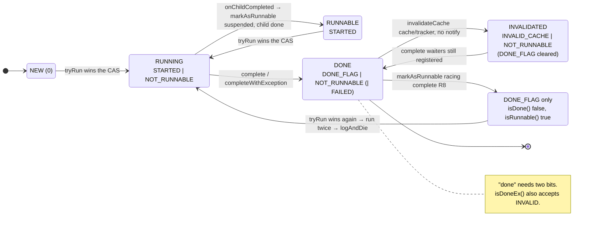
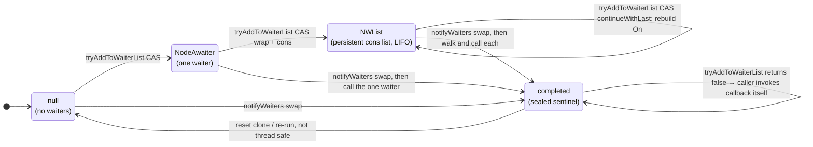
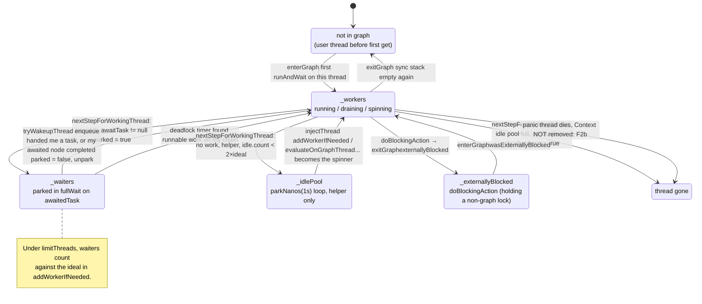

# A field guide to the cirrus scheduler

A whistle-stop tour of the data structures and concurrency techniques in `optimus.graph`, written for a human doing a concurrency review. It says what each piece is, which well-known system it most resembles, where the resemblance breaks down, and what to look at. It deliberately does not repeat the findings in [SCHEDULER_REVIEW.md](SCHEDULER_REVIEW.md); where a section ends with "see Rn", that is the pointer.

All paths are under `optimus/platform/projects/core/src/main/scala/optimus/graph/`.

## 1. The node: a future, a task and a graph edge in one object

`NodeTask` is the unit of work. It is at once a lazily computed future (it has a result or an exception), a schedulable task (it has `run(OGSchedulerContext)`), and a vertex in two graphs: the *waiter* graph (who wants my result) and the *waitingOn* chain (what I am blocked on). `Node[T]` and `CompletableNode[T]` in `Node.scala` add the typed result; the `@node` macros and the Loom-based async transformation in `loom/` generate subclasses whose `run` is a resumable state machine (`NodeStateMachine`).

The whole lifecycle lives in one `volatile int _state` mutated with CAS loops (`updateState`, `tryUpdateState`). The low five bits are the run state: `STARTED`, `NOT_RUNNABLE`, `DONE_FLAG`, failed, hide-exception. Higher bits are orthogonal flags: scenario-dependent, cache-invalidated, tracking, adapted by a plugin, visited-gray/black for graph walks, and so on.

```java
// NodeTask.java, distilled. All transitions are CAS loops on one int.
static final int STATE_STARTED      = 1;   // run() has been entered at least once
static final int STATE_NOT_RUNNABLE = 2;   // clear = eligible to be picked off a queue
static final int STATE_DONE_FLAG    = 4;   // has a result or exception
static final int STATE_DONE = STATE_DONE_FLAG | STATE_NOT_RUNNABLE;   // "done" is TWO bits
private static final int STATE_INVALID_CACHE = 0x40;                  // set by the cache/tracker, not the scheduler

protected final int updateState(int set, int clear) {      // unconditional: whatever is there, set/clear bits
  int prev, next;
  do { prev = _state; next = (prev | set) & ~clear; } while (!state_h.compareAndSet(this, prev, next));
  return prev;                                               // callers decide from the PREVIOUS value
}
private int tryUpdateState(int set, int clear) {           // conditional: refuses once DONE is observed
  int prev, next;
  do {
    prev = _state;
    if ((prev & STATE_DONE) == STATE_DONE) return prev;
    next = (prev | set) & ~clear;
  } while (!state_h.compareAndSet(this, prev, next));
  return prev;
}

// The one CAS everything else leans on: a task on two queues, or handed out twice, runs once.
protected final int tryRun() { return updateState(STATE_STARTED | STATE_NOT_RUNNABLE, 0); }
// OGSchedulerContext.run():  if ((ntsk.tryRun() & STATE_NOT_RUNNABLE) == 0) { ... ntsk.run(this) ... }

// Two siblings that do the same job, one check-then-act, one re-checking inside the loop (compare: R8).
final void markAsRunnable()    { if (!isDoneOrRunnable()) updateState(0, STATE_NOT_RUNNABLE); }
final boolean tryMarkAsRunnable() { return !isDone(tryUpdateState(0, STATE_NOT_RUNNABLE)); }

// Predicates with different masks; a state like DONE_FLAG|STARTED answers them differently.
public final boolean isDone()   { return (_state & STATE_DONE) == STATE_DONE; }
public final boolean isDoneEx() { return (_state & (STATE_DONE_FLAG | STATE_INVALID_CACHE)) != 0; }
final boolean isRunnable()      { return (_state & STATE_NOT_RUNNABLE) == 0; }

// Completion: book-keeping first, then the state CAS (the publish barrier), then notify.
protected final void complete(EvaluationQueue eq, int doneState) {
  OGTrace.completed(eq, this);                               // stats visible before anyone can read the result
  int prev = tryUpdateState(doneState, clearFlags);          // STATE_DONE or STATE_DONE_FAILED
  if (isDone(prev)) logAndDie(new GraphException("Cannot complete node twice!"));   // process-fatal
  notifyWaiters(eq);
}
```

The run-state bits as a state machine (flag bits above bit 5 are orthogonal and not shown):



**Parallels.** `java.util.concurrent.FutureTask` (state word with CAS transitions), `CompletableFuture` (result plus a lock-free completion-callback stack), Rust's `Future` plus a `Waker`. The closest is Kotlin coroutines' `DispatchedTask`/`JobSupport`: state machine, children, cancellation all in one object.

**Where it differs.** `FutureTask` has four states and one transition path. `NodeTask` has 23 flag bits and many writers: the scheduler (`tryRun`, `markAsRunnable`), the cache (`invalidateCache` clears `DONE_FLAG`), plugins (`markAsAdapted`), the dependency tracker, graph walkers (`VISITED_*`). The one rule that matters: `run()` is guarded by the CAS in `tryRun` that sets `NOT_RUNNABLE`; everything downstream assumes a task that fails that CAS was not run twice. "Done" is `DONE_FLAG | NOT_RUNNABLE`, two bits, so a writer that clears one can produce a state the predicates disagree about.

**What to check.** Every method that reads `_state` then writes it: is the write a `tryUpdateState` (re-checks done inside the loop) or a plain `updateState`? Every predicate (`isDone`, `isDoneEx`, `isDoneOrRunnable`, `isDoneOrNotRunnable`) has a slightly different mask; find the callers that rely on the differences. See R8, R6.

## 2. The waiter list: a persistent linked list swapped by CAS

`NodeTask._waiters` holds who to notify on completion. It is a tagged union: `null`, a single `NodeAwaiter`, an `NWList` (immutable singly linked list), or the sentinel `completed`. `tryAddToWaiterList` copies-and-CASes; `notifyWaiters` swaps in `completed` and walks what it got. A registration that loses to completion returns false and the caller invokes the callback itself, so every waiter is called exactly once.

```java
// NodeTask.java, distilled.
private transient volatile Object _waiters;   // null | NodeAwaiter | NWList | completed (sentinel)
protected static final Object completed = new Object();

public final boolean tryAddToWaiterList(NodeAwaiter waiter) {
  waiter.setWaitingOn(this);                   // forward edge for cycle detection, set optimistically
  while (true) {
    Object prev = _waiters;
    if (prev == completed) { waiter.setWaitingOn(null); return false; }   // lost: caller must notify itself
    Object next = (prev == null) ? waiter : new NWList(waiter, asList(prev));   // persistent cons, LIFO
    if (waiters_h.compareAndSet(this, prev, next)) return true;
  }
}

private void notifyWaiters(EvaluationQueue eq) {
  Object ws;                                   // atomically seal the list: nobody can register after this
  do { ws = _waiters; } while (!waiters_h.compareAndSet(this, ws, completed));
  for (NodeAwaiter w : walk(ws)) {             // synchronously, on the completing thread
    w.setWaitingOn(null);
    w.onChildCompleted(eq, this);              // default impl below; eq may be a scheduler, not a context
  }
}

// The contract every caller follows: register, and if that fails, call back inline.
public final void continueWith(NodeAwaiter waiter, EvaluationQueue eq) {
  if (!tryAddToWaiterList(waiter)) waiter.onChildCompleted(eq != null ? eq : OGSchedulerContext.current(), this);
}

// Default reaction of a parent node: become runnable again and get back on a queue. [MUST_ENQUEUE]
@Override protected void onChildCompleted(EvaluationQueue eq, NodeTask child) {
  markAsRunnable();
  eq.enqueue(null, this);                      // the completer's queue, i.e. some other thread's deque
}
```



**Parallels.** `CompletableFuture`'s Treiber stack of `Completion` nodes with the `null`/stack/done states; `AbstractQueuedSynchronizer`'s CLH queue; JavaScript promise reaction lists. The exactly-once-via-CAS contract is the same one as in `CompletableFuture.uniPush`.

**Where it differs.** Callbacks run synchronously on the completing thread (`onChildCompleted`), and the default callback is "mark me runnable and enqueue me on the *completer's* queue". There is a stack-depth guard (`delayOnChildCompleted`, `proxyChainStackLimit`) rather than a trampoline. `continueWithLast` appends by rebuilding the list, O(n), for the rare "notify me after everyone else" case. Waiters are usually `NodeTask`s themselves but can be `SyncFrame`s (see §5) or ad hoc `NodeAwaiter`s.

**What to check.** Who else reads `_waiters` without the CAS protocol (graph walkers, debug dumps). What `onChildCompleted` is allowed to do on an arbitrary thread with an `EvaluationQueue` that may be a scheduler rather than a context. Objects reused while still on a list. See R6, W3a–c.

## 3. The work-stealing deque: a Chase–Lev variant with at-least-once semantics

`OGSchedulerContext.WorkQueue` is a circular array with an owner-only `_top` and a volatile `_base`. The owner pushes and pops at the top; thieves CAS a slot to null at the base and advance `_base` under `synchronized (this)`. Growth copies live tasks into a doubled array and swaps. A sync frame can fence the owner off tasks below a captured `_top` (`currentLocalQueueMarker`), and `scanToFindWork` does a linear, causality-checked search for the desperate case.

```java
// OGSchedulerContext.WorkQueue, distilled.
private NodeTask[] _q = new NodeTask[64];     // power of two; index & (length-1)
private volatile int _base;                   // thieves take here
private int _top;                             // owner only; plain field, published by TSO + the slot CAS

final void localPush(NodeTask task) {         // owner
  if ((_top - _base) >= mask) growArray(_base - 1);           // grow before full; copies live tasks, may re-copy stolen ones
  queue_h.setOpaque(_q, _top & mask, task);
  _top = _top + 1;
  if (_top == Integer.MAX_VALUE) resetBounds(mask);           // one-shot: _top &= mask; _base &= mask (see R2)
}

final NodeTask localPop(int topLimit) {       // owner; topLimit is a sync frame's fence
  int top = _top - 1;
  if (topLimit > top || top < _base) return null;             // direct comparisons, not differences
  NodeTask r = (NodeTask) queue_h.get(_q, top & mask);
  if (r != null && queue_h.compareAndSet(_q, top & mask, r, null)) _top = top;
  return r;                                   // NOTE: returned even if the CAS failed; tryRun arbitrates (R7)
}

final NodeTask tryToSteal() {                 // any thread
  synchronized (this) {                       // thieves serialised; FJP uses a CAS on base instead
    int base = _base;
    NodeTask r = (NodeTask) queue_h.getVolatile(_q, base & mask);
    if (r != null && queue_h.compareAndSet(_q, base & mask, r, null)) { base_h.setOpaque(this, base + 1); return r; }
  }
  return null;
}

// "Unstable value!" in the source: with grow/steal races it can overstate pending work.
final int size() { return _top - _base; }
```

And the fence that ties the deque to the sync stack (§5):

```java
// OGSchedulerContext.runAndWait, distilled: when this frame must not run work from older frames,
// remember where the queue was and only pop above it.
if (!prevNode.executionInfo().atMostOneWaiter() || syncStack.count > Settings.syncStackSafetyLimit) {
  currentCausalityID += 1;
  currentLocalQueueMarker = localQ.getTop();   // an absolute index remembered outside the queue
}
drainQueue(ntsk, currentLocalQueueMarker);     // -> localQ.localPop(currentLocalQueueMarker) ...
```

**Parallels.** `ForkJoinPool.WorkQueue` (same shape, same "owner at top, thieves at base", same `& mask` indexing), .NET `ThreadPool`'s `WorkStealingQueue`, Tokio's `Local` run queue, Go's per-P run queue. The class comment cites the Chase–Lev and "idempotent work stealing" papers and explains why it departs from them.

**Where it differs.** This is explicitly *not* linearizable: a task may be present in two queues (grow copies while thieves steal), may be returned to two takers (owner's failed CAS still returns `r`), and `size()` is "unstable". The design pushes correctness down to `tryRun` (§1) rather than into the queue; Michael et al. call this idempotent work stealing, and ForkJoinPool explicitly rejects it. Thieves are serialised on the queue's monitor, which FJP avoids. Indices are compared directly rather than by difference, with a one-shot `resetBounds` at `Integer.MAX_VALUE`; FJP's indices wrap naturally because it only ever compares `top - base`.

**What to check.** Every reader of `size()`/`isEmpty()` that treats the value as a count. Every piece of state outside the queue that remembers an index. Whether the "+1 overrun" state in the class comment is still reachable. See R2, R7, and the jcstress/Lincheck tables.

## 4. The scheduler: a work pool with one big lock, one spinner, and three thread sets

`OGScheduler` keeps every graph thread's `Context` in one of `_workers` (running), `_waiters` (blocked in a sync wait), `_idlePool` (parked helper), or `_externallyBlocked` (temporarily out of the graph). These are `IndexedArrayList`s: packed arrays with swap-remove and an index stored on the item, O(1) everything, no checking, "all methods are expected to be called under a lock". Two global queues back the per-thread deques: `_qqueue` (a `WorkQueue` owned by whoever holds `_lock`) and `_queue` (a `PriorityQueue` for nodes with a non-zero priority, used by batchers).

Thread count is governed by an *ideal* (`optimus.gthread.ideal`, cores by default), a single *spinning thread* id used as a gate so that at most one new thread is being ramped up at a time, and an idle pool capped at twice the ideal. New workers are injected only by `addWorkerIfNeeded`, which under `limitThreads` counts waiters against the ideal.

```java
// OGScheduler.java, distilled.
private final Object _lock = new OGSLock();                 // the big lock; ~23 synchronized sites
private final Contexts _workers, _waiters, _idlePool, _externallyBlocked;   // IndexedArrayList<Context>
private final WorkQueue _qqueue;                            // global quick queue; "owner" = whoever holds _lock
private final PriorityQueue<NodeTask> _queue;               // priority != 0 (batchers); only under _lock
private volatile int _spinningThreadID;                     // 0 = nobody spinning; the ramp-up gate

public final void enqueue(NodeTask ntsk) {                  // from a non-graph thread or across causality
  synchronized (_lock) {
    for (Context ctx : waiters)                             // first: hand it to a blocked thread that may take it
      if (canTake(ntsk, ctx.threadID, ctx.awaitedCausalityID)) { wakeupThread(ntsk, ctx); return; }
    if (ntsk.priority() == 0) _qqueue.localPush(ntsk); else _queue.offer(ntsk);
    addWorkerIfNeeded();
  }
}

private boolean addWorkerIfNeeded() {                       // under _lock
  if (_spinningThreadID != 0) return false;                 // one ramp-up at a time
  int active = _workers.count + _waiters.count;
  if (Settings.limitThreads && active >= _idealCount) return false;   // waiters count against the ideal (see R10)
  if (_workers.count >= _idealCount) return false;
  return injectThread(null);                                // pops the idle pool or new OGThread().start(), still under _lock
}

// A helper thread's life: run what it can, spin if it is the spinner, else park in the idle pool.
class OGLogicalThread implements Runnable { public void run() {
  while (true) {
    NodeTask t = spin(ctx, null);                           // findWork() in a Thread.yield() loop while _spinningThreadID == me
    if (t == null) t = nextStepForWorkingThread(ctx, null); // under _lock: last look, then move to idle/shutdown
    if (t != null) { ec.drainQueue(t, -1); continue; }
    while (ctx.parked) LockSupport.parkNanos(ONE_SECOND);   // idle; woken by injectThread/shutdown
    if (ctx.shutdown) break;
  }
}}

// IndexedArrayList, the thread sets: packed array, O(1) swap-remove, index cached on the item.
public final boolean tryRemove(T item) {
  int i = item.index;
  if (i < 0 || i >= count || q[i] != item) return false;
  count--; q[i] = q[count]; q[i].index = i; q[count] = null; item.index = -1;   // last item moves into the hole
  return true;
}
public final void foreach(Consumer<T> c) { for (T x : q) { if (x == null) break; c.accept(x); } }   // no lock of its own
```

A `Context` (one per graph thread) moves between the four sets under `_lock`:



**Parallels.** ForkJoinPool's `ctl` word and "signalWork" ramp-up (one activator at a time), Go's `spinning M` (at most GOMAXPROCS/2 spinning, the rest parked), Tokio's single "searching" worker gate, .NET's hill-climbing thread injection. The idle pool with `parkNanos(1 s)` is the classic "keep a few warm threads" trick.

**Where it differs.** FJP and Go are lock-free on the hot path; here `enqueue` from outside, every wake-up, thread injection, stall handling, cycle detection and the stalled callbacks all run under one `synchronized (_lock)` (23 sites). The spinner uses `Thread.yield()` in a loop rather than `onSpinWait` plus timed park. Waiting threads are first-class citizens of the pool: a thread blocked in a sync wait is still "in the graph", helps by stealing, and counts toward the ideal.

**What to check.** What runs while holding `_lock` (user callbacks? thread start?). What happens to a `Context` when its thread dies unexpectedly. Whether every transition between the four sets keeps the spinner id consistent. See F2b, I3, I4, W6d.

## 5. Sync stacks and causality: the part with no textbook

Optimus code can call `node.get` from inside a running node. That blocks the thread in `runAndWait`, which pushes a `SyncFrame`, registers the frame as a waiter on the awaited node, and then *helps*: it drains its own queue and steals from others until the awaited node is done. The frames on a thread form its *sync stack*. This is "blocking by helping", as in FJP's `helpJoin`/`awaitJoin` and `CompletableFuture.join` on a pool thread, but with an extra problem: if the thread helps by running a task that itself (transitively) needs a node that is suspended lower on this very stack, it deadlocks itself.

The defence is *causality*. Each sync frame that could matter bumps `currentCausalityID` (a depth) on the context; every task the thread runs is stamped `(threadID, depth)` into `NodeTask._causality` (two 16-bit halves of one int). `canTake(task, threadID, depth)` lets a thread at depth `d` take only tasks stamped with its own id at depth ≥ `d`, or tasks with no stamp at all; the forward-chain walk in `wait()` re-stamps the chain so the awaited work is always takeable; `poisonCausality` marks work that nobody with a sync stack may touch. The whole thing is a cheap, conservative approximation of "would running this put me below myself?"

A sync `get` whose child is finished by another thread, end to end:

```mermaid
sequenceDiagram
    autonumber
    participant T as Thread T<br/>(OGSchedulerContext)
    participant S as OGScheduler<br/>(_lock)
    participant N as Node N<br/>(_waiters)
    participant W as Thread W<br/>(completer)

    T->>T: runAndWait(N): push SyncFrame, prevNode.waitingOn = N,<br/>causality += 1, marker = localQ.top
    T->>N: tryAddToWaiterList(frame)  (CAS)
    T->>T: drainQueue(N, marker): tryRun(N) … N suspends on a child
    loop until N.isDoneEx()
        T->>S: wait(N, ctx, causality)
        S->>S: spin / steal / scanToFindWork (canTake-checked)
        S->>S: findWorkOnForwardChain(N): re-stamp chain, run its tail if runnable
        S->>S: nextStepForWorkingThread: _workers → _waiters, parked = true
        T->>T: fullWait: park() (1 s timer: chain walk, stalled-callback recovery)
    end
    W->>N: complete(): tryUpdateState(DONE) then notifyWaiters()
    N->>T: frame.onChildCompleted(eqW, N)   (synchronous, on W)
    T->>S: awakeOnComplete(N, ctxT)   [SyncFrame → scheduler]
    S->>S: ctx.awaitedTask == N ? tryWakeupThread: _waiters → _workers,<br/>parked = false, unpark(T.thread)
    T->>T: fullWait returns ctx.awaitedTask; loop sees N.isDoneEx()
    T->>T: finally: restore causality/marker, waitingOn = null, pop frame,<br/>exitGraph if the stack is empty
```

Hand-off of global work to a parked waiter, the path that R9 abuses:

```mermaid
sequenceDiagram
    autonumber
    participant X as non-graph thread<br/>(promise completes P)
    participant S as OGScheduler.enqueue<br/>(_lock)
    participant T as Thread T<br/>parked at depth d on S'
    X->>X: P.complete(scheduler): notifyWaiters → Z.onChildCompleted
    X->>S: enqueue(Z)   (Z stamped (T, d₀) by a frame that has since popped)
    S->>S: for each waiter ctx: canTake(Z, ctx.threadID, ctx.awaitedCausalityID)?
    Note over S: depth d ≤ d₀ and same thread id → true
    S->>T: wakeupThread: ctx.awaitedTask = Z, parked = false, unpark
    T->>T: fullWait returns Z; drainQueue(Z) runs Z inside the frame waiting on S'
    T->>T: Z's continuation: runAndWait(S') … S' is suspended lower on T's own stack
    Note over T: parks on S'. No waitingOn cycle, nothing runnable: permanent.
```

```java
// OGSchedulerContext.runAndWait, distilled: block-by-helping with a sync frame.
public final void runAndWait(NodeTask ntsk) {
  NodeTask prevNode = _currentNode;                          // the node that called .get
  prevNode.setWaitingOn(ntsk);                               // forward edge: prevNode -> ntsk
  if (syncStack.isEmpty()) _scheduler.enterGraph(_context, false);   // user thread joins the pool
  SyncFrame frame = syncStack.push(prevNode);                // frames are pooled objects, reused after pop
  if (!prevNode.executionInfo().atMostOneWaiter() || syncStack.count > syncStackSafetyLimit) {
    currentCausalityID += 1;                                 // depth, not identity
    currentLocalQueueMarker = localQ.getTop();
  }
  ntsk.tryAddToWaiterList(frame);                            // frame.onChildCompleted -> scheduler.awakeOnComplete(ctx)
  drainQueue(ntsk, currentLocalQueueMarker);                 // help: run ntsk and whatever is above the fence
  while (!ntsk.isDoneEx()) {                                 // isDoneEx: DONE_FLAG *or* INVALID_CACHE
    NodeTask other = _scheduler.wait(ntsk, _context, currentCausalityID);   // steal/scan/park, causality-checked
    drainQueue(other, currentLocalQueueMarker);
  }
  // finally: restore causality/marker, prevNode.setWaitingOn(null), syncStack.pop(), maybe exitGraph
}

// The stamp, written in OGSchedulerContext.run() for every task this thread runs...
final void setCausality(int causality, int threadID) { _causality = (causality & 0xFFFF) | (threadID << 16); }
final int causalityID()       { return _causality & 0xFFFF; }
final int causalityThreadID() { return _causality >> 16; }   // arithmetic shift (see R1)
final void poisonCausality()  { setCausality(1, Integer.MAX_VALUE); }   // "nobody with a sync stack may take this"

// ...and the check, OGScheduler.canTake: may a thread at depth `causalityID` run `task`?
static boolean canTake(NodeTask task, int threadID, int causalityID) {
  if (causalityID == 0) return true;                         // no sync stack: anything goes
  int tid = task.causalityThreadID(), cid = task.causalityID();
  return (cid == 0 && tid == 0)                              // never stamped
      || (causalityID <= cid && (tid == threadID || tid == 0));   // my own work, from this depth or deeper (see R9)
}

// wait(): before parking, walk the awaited chain (Floyd) re-stamping it so its tail is takeable by me.
for (NodeTask t = awaitTask.getWaitingOn(); t != null && t != fast; t = t.getWaitingOn()) {
  t.setCausality(ctx.awaitedCausalityID, ctx.threadID);
  if (t.isRunnable() && t.valueWasRequested()) return t;     // run the end of my own chain myself
}
```

**Parallels.** FJP's join helping (`tryHelpStealer`, `helpComplete`) only helps with tasks that are descendants of the joined task; Go's scheduler simply forbids blocking a P and hands the M off. Causality is closer to the "lock levels" trick in deadlock-avoidance schemes: a monotone number per stack that bounds what you may wait on. Loom's answer, used in the `loom-on` build, is to let the carrier go and never block the thread at all; that is why `limitThreads` is tied to `useVirtualThreads`.

**Where it differs.** Depth is not identity: two frames of the same thread at the same depth share a stamp. The stamp lives on the task and outlives the frame that wrote it. Under `limitThreads` no spinner with causality 0 is guaranteed to exist, so work that no waiter may take relies on other recovery. See R1, R9, R10.

**What to check.** Every path that stamps, every path that compares, and what each assumes about the lifetime of the other. `wait()`, `findWorkOnForwardChain`, `enqueue`'s waiter scan, `nextStepForWorkingThread`, `scanToFindWork`.

## 6. Stalls, batching and the out-of-work listeners

When the last working thread cannot find anything to run, the graph has *stalled*. That is a feature, not a failure: plugins such as the DAL batcher register `OutOfWorkListener`s and use the stall as the moment to fire a batch of deferred requests, so the engine is a natural batching system in the style of Haxl or Facebook's `DataLoader`. Listeners have priorities and are called in passes; a pass stops when a callback added work. `mustCallDelay`/`mustWaitDelay` add timers via `ScheduledNodeTask`.

```mermaid
sequenceDiagram
    autonumber
    participant C as client thread<br/>(sync get on R)
    participant S as OGScheduler<br/>(_lock held throughout)
    participant B as DAL batcher<br/>(OutOfWorkListener)
    participant IO as remote service

    C->>S: wait(R): findWork(…, desperateSearchUnderLock = true)
    S->>S: nothing on any queue; isStalling(ctx) → _workers.count == 1
    S->>B: checkForNewWork(scheduler)   (every listener, for-each over the PriorityQueue)
    S->>B: onGraphStalled(scheduler, outstanding)   (highest priority first; deregistered when called)
    B->>IO: send the batch of N deferred node requests
    B->>S: later, from an IO thread: node.complete(…) / scheduler.enqueue(…)
    S->>S: newWorkAdded? re-scan _qqueue / _queue; else next priority
    S->>S: still nothing and _workers.count == 1: detectCycles over waiters and tracked nodes
    S-->>C: null → fullWait: park; 1 s timer re-checks "callbacks pending and no workers"
```

```java
// OGScheduler.findWork (desperate path, under _lock) and runOnStalledCallbacks, distilled.
if (isStalling(ctx)) {                                   // I am the last working thread and found nothing
  while (runOnStalledCallbacks()) {                      // each pass may add work; re-scan after each
    if ((t = _qqueue.scanToFindWork(ctx.threadID, ctx.awaitedCausalityID)) != null) return t;
    if ((t = findWorkFromLowPriorityQueue(ctx)) != null) return t;
  }
  if (_workers.count == 1 && _runCycleDetectionOnStall) {   // still stuck: look for cycles, once per wait
    _waiters.foreach(this::detectCycles);
    _evalAsyncTrackedNodes.foreach(tracked -> detectCycles(tracked.task));   // its own monitor is not taken here (R3)
  }
}

private boolean runOnStalledCallbacks() {                // still under _lock (TODO OPTIMUS-17080)
  _onStalledCallbacksInProgress = true;                  // adds during the pass go to a pending list...
  for (var cb : _onStalledCallbacks) cb.checkForNewWork(this);   // ...but this for-each has no such protection (F2)
  int before = _queue.size() + _qqueue.size();
  OutOfWorkListener cb; int priority = _onStalledCallbacks.peek().priority();
  while ((cb = _onStalledCallbacks.peek()) != null && (cb.priority() == priority || !newWorkAdded)) {
    _onStalledCallbacks.poll();                          // a callback is deregistered once called
    cb.onGraphStalled(this, outstandingTasks);           // user code, e.g. "send the DAL batch now"
    newWorkAdded = (_queue.size() + _qqueue.size()) != before;   // size() of a deque as a count
  }
  ...
}
```

**Parallels.** Haxl's "run until blocked, then fetch everything blocked on", GraphQL DataLoader's "batch at the end of the tick", Seastar's idle-time hooks.

**Where it differs.** Callbacks run under `_lock` (an acknowledged TODO), iterate a `PriorityQueue` with a reentrant lock held, and are the only thing standing between a stall and a hang. Recovery for "nobody called the callbacks" is a 1 s timer in `fullWait`.

**What to check.** Reentrancy (a callback that registers/removes), exceptions from callbacks, and whether a stall is detected when the last worker leaves abnormally. See F2, F2b, W5a–c.

## 7. Cycle detection: Floyd on the waitingOn chain, under a global lock

Every blocked thread's awaited task has a `waitingOn` chain. `findWorkOnForwardChain` walks it with a fast and a slow pointer (Floyd), re-stamping causality and returning the first runnable node. If the walk finds a cycle, `detectCyclesAndRecover` runs under the static `NodeTask._visitLock`: it collects the cycle, tries plugin-specific recovery (`tryToRecoverFromCycle`, used by the cross-scenario proxies to loosen a tweak-dependency mask), and otherwise completes one node with `CircularReferenceException`. The lock order `_lock` → `_visitLock` is documented in a comment and is what makes the recovery enqueue safe.

```java
// NodeTask.visitForwardChain (Floyd) and detectCyclesAndRecover, distilled.
NodeTask slow = this, fast = this;
do {
  v.add(slow);
  slow = slow.getWaitingOn();
  if (fast != null) { fast = fast.getWaitingOn(); if (fast != null) fast = fast.getWaitingOn(); }
} while (slow != null && slow != fast);                  // slow == fast: a cycle; slow == null: chain ended
// Note what is NOT a cycle here: a sync frame suspended lower on the same thread (R9 forms no waitingOn loop).

private static final ReentrantLock _visitLock = new ReentrantLock();   // static: one walker per JVM, all schedulers

void detectCyclesAndRecover(EvaluationQueue eq) {
  _visitLock.lock();                                     // caller already holds this scheduler's _lock [SEE_XSFT_GLOBAL_SCHEDULER_ENQUEUE]
  try {
    if (isDone()) return;
    var chain = visitForwardChain();
    if (chain.marker < 0) return;                        // no cycle
    for (NodeTask t : cycle(chain))
      if (t.tryToRecoverFromCycle(mask, eq)) return;     // plugin hook; may enqueue, i.e. take some scheduler's _lock (R4)
    chain.get(chain.marker).completeWithException(new CircularReferenceException(chain), eq);   // break it
  } finally { _visitLock.unlock(); }
}
```

**Parallels.** Deadlock detection by wait-for graph (database lock managers, Go's `runtime.checkdead`), run on a timer when progress stops rather than on every wait. Completing a node with an exception to break the cycle is the same move as a database aborting the youngest transaction.

**What to check.** The lock order with more than one scheduler alive; which structures the walk reads without their own lock; the asymmetry between what is detected (waitingOn cycles) and what can actually deadlock (sync-stack inversions that form no cycle). See R3, R4, R9.

## 8. Cancellation: scopes, not interrupts

`CancellationScope` is a tree; cancelling a scope marks it and every child. The scheduler checks `cs.isCancelled()` in `run()` before running a node and completes it with the cancellation cause instead. Nodes already running are not interrupted; `waitForCancelledNodesToStop` polls the contexts' current nodes and sync frames until none of them is in the scope, with a check for the self-deadlock of waiting on a cancelled node that is on your own sync stack.

```java
// OGSchedulerContext.run(), distilled: cancellation is checked once, before run(), never during.
private void run(NodeTask ntsk) {
  int prev = ntsk.tryRun();
  if ((prev & STATE_NOT_RUNNABLE) != 0) return;          // someone else has it
  _currentNode = ntsk;                                   // plain write; read by other threads' polling loops
  ntsk.setCausality(currentCausalityID, _context.threadID);
  try {
    if (ntsk.scenarioStack().cancelScope().isCancelled()) ntsk.cancelInsteadOfRun(this);   // completes with the cause
    else ntsk.run(this);
  } catch (Throwable ex) {
    ntsk.completeWithException(ex, this);               // fatal if ntsk already completed itself (F1)
  } finally { _currentNode = null; }
}

// OGScheduler.waitForCancelledNodeToStop, distilled: poll until the node is off every stack.
while ((frame.getCurrentNodeTask() == node || owner.getCurrentNodeTask() == node) && node.notWaitingForCancelledNodesToStop()) {
  if (frame instanceof SyncFrame && node.visitForwardChain().containsEQ(callerNode)) throw new GraphInInvalidState("would deadlock");
  Thread.yield();                                        // plain-field reads in a spin loop (R5)
}
```

**Parallels.** Go's `context.Context` tree, Kotlin's structured concurrency `Job` hierarchy, .NET `CancellationToken`. The "cooperative, checked at scheduling points" model is the standard one.

**What to check.** The polling loop reads plain fields; cancellation racing completion (both complete the node); cancellation while a node is on a sync stack. See R5, H6.

## 9. The cache and proxies (only as far as the scheduler cares)

`cache/` holds node caches keyed by property and scenario stack, with proxies (`DelayedXSProxyNode`, `DelayedXSFTProxyNode`) that stand in for a possible cache hit while the "real" node runs elsewhere and complete by copying its result. Proxies are `NodeTask`s and therefore participate in waiter lists, forward chains and causality; cycle recovery exists mainly for them, and `delayOnChildCompleted` exists because proxy chains can be long. `invalidateCache` clears a node's `DONE_FLAG` from the dependency tracker's side.

**Parallels.** Memoising futures (Guava `LoadingCache` with `Future` values), Salsa and Adapton for the incremental-recomputation side (tweaks, dependency tracking, invalidation).

**What to check.** Any state transition made to a node by the cache or tracker rather than by the scheduler, and which scheduler predicates it changes. See R6.

## 10. Diagnostics, profiling and the agent

A lot of the code is observability: `OGTrace`/`OGLocalTables` per-thread profiling tables acquired and released on graph entry/exit, `PNodeTask` profile records, breadcrumbs, stall printing with rate limits, `GraphDiagnostics` dumps, `InfoDumper.graphPanic` as the kill switch. The entity agent (`entityagent/`) rewrites classes at load time: it adds fields to `TPDMask`, instruments `NodeTask`, and in the Loom build rewrites async code to continuations. The class you read is not quite the class that runs.

```java
// NodeTask.logAndDie and OGScheduler.panic, distilled: the fail-fast path.
private static boolean inLogAndDie = false;              // static, non-volatile, never reset

private void logAndDie(Throwable e) {
  synchronized (NodeTask.class) {
    if (inLogAndDie) { log.error("logAndDie called recursively!"); return; }   // the guard (F1b)
    inLogAndDie = true;
    log.error(...); log.error(GraphDiagnostics.getGraphState());
    InfoDumper.graphPanic("logAndDie", ..., 121, wrapped, this);   // -> crumbs, dump, Runtime.exit(121); each step can throw
  }
}
// OGLogicalThread.run():  try { ...loop... } catch (Throwable e) { panic(e); }   // panic -> graphPanic(66); no finally removes ctx from _workers (F2b)
```

**Parallels.** JFR-style per-thread buffers, async-profiler integration, the "crash the process on invariant violation" discipline of Erlang supervisors or SQLite's `SQLITE_CORRUPT`.

**What to check.** Whether diagnostics can throw on the kill path, and what the recursion guards do then. Whether a probe or test is running the instrumented class. See F1, F1b, F6.

## 11. Settings and build-time switches

`Settings` and `DiagnosticSettings` are `static final` fields read from system properties once. `optimus.scheduler.asserts` turns on the scheduler's own invariant checks (there are no Java `assert`s). `optimus.graph.useVirtualThreads` defaults to a constant that depends on which entityagent source set was compiled (`loom-on`/`loom-off`), and `limitThreads` defaults to its negation. `gthread.ideal` of -1 means "all cores, at least 4".

**What to check.** Which configuration you are actually in before interpreting a run. See F5, F7.

## A reviewer's checklist, by technique

| Technique | Where | Textbook reference | The local twist |
|-----------|-------|--------------------|-----------------|
| State word + CAS loop | `NodeTask._state` | `FutureTask`, AQS | many writers, two-bit "done" |
| Lock-free callback list | `NodeTask._waiters` | `CompletableFuture` | synchronous callbacks, reusable frames |
| Chase–Lev deque | `WorkQueue` | FJP, Tokio | at-least-once, direct index compares, sync markers |
| Single-spinner ramp-up | `_spinningThreadID` | FJP `signalWork`, Go spinning M | `Thread.yield`, under `_lock` |
| Packed thread sets | `IndexedArrayList` | FJP's `queues[]` | swap-remove with unlocked readers |
| Blocking by helping | `runAndWait` | FJP `awaitJoin` | sync stacks, causality stamps |
| Causality / lock levels | `_causality`, `canTake` | lock-level deadlock avoidance | depth not identity, 16-bit packing |
| Stall-driven batching | `OutOfWorkListener` | Haxl, DataLoader | callbacks under the big lock |
| Wait-for cycle detection | `detectCyclesAndRecover` | DB deadlock detectors | static lock, plugin recovery |
| Scoped cancellation | `CancellationScope` | Go context, Kotlin Job | polling stop-wait on plain fields |
| Fail-fast kill | `logAndDie`, `panic` | Erlang let-it-crash | kill path can throw |

The campaign in [TEST_CAMPAIGN.md](TEST_CAMPAIGN.md) attacks the rows of this table one at a time; the probe harness in `probes/` is the practical way to answer "is this reachable?" for any new concern you form while reading.
