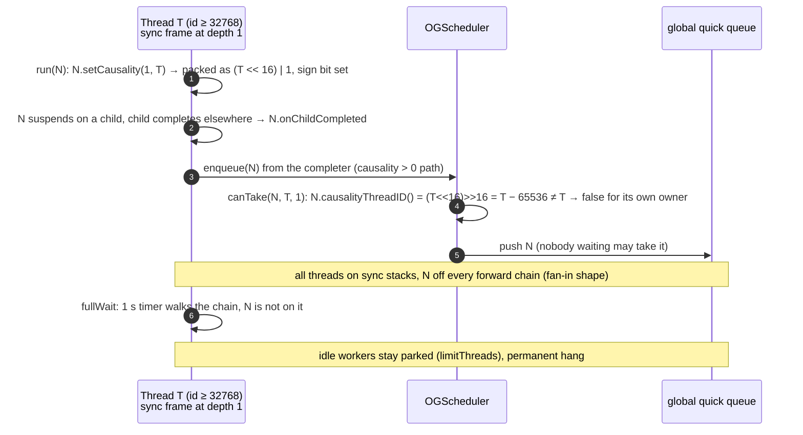
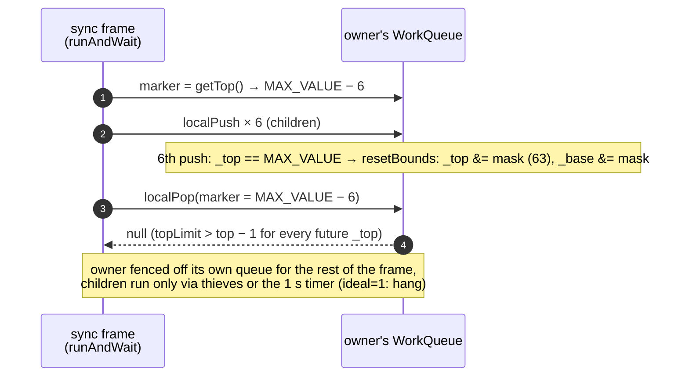
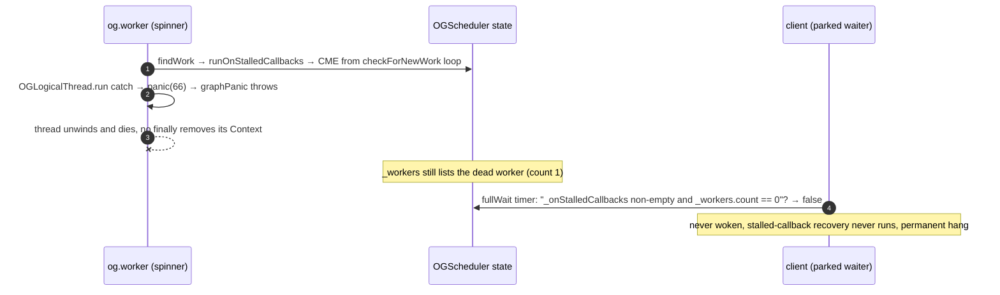
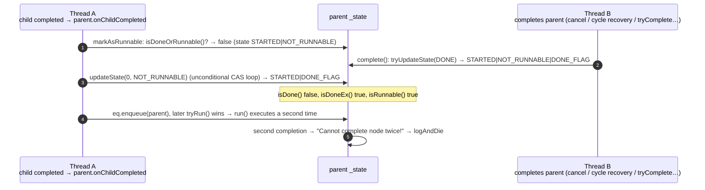
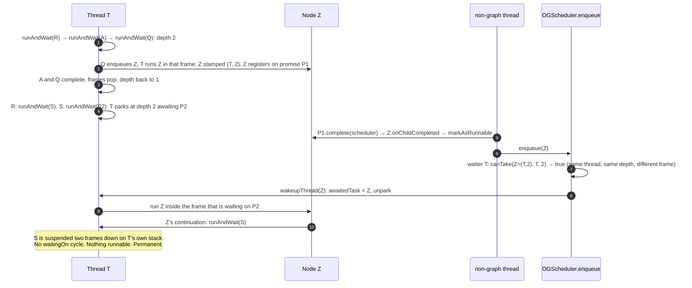
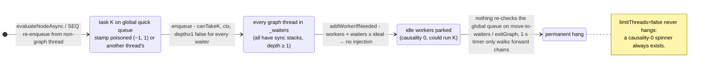
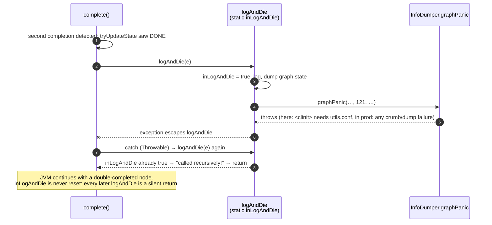

# Cirrus core scheduler review

Scope: `optimus/platform/projects/core/src/main/scala/optimus/graph/{OGScheduler.java, OGSchedulerContext.java, NodeTask.java, NodeAwaiter.java, Scheduler.scala, Node.scala, OGLocalTables.java, Settings.java}` plus `optimus/core/IndexedArrayList.java` and the cycle-recovery entry points in `cache/NCProxies.java`. Read, not run (see the build section at the end for what could be executed locally). Line numbers refer to the current worktree.

Severity key: **H** likely to bite in production, **M** real but needs specific conditions, **L** hygiene / latent.

## Races and correctness

### R1 (H, permanent hang demonstrated end to end) Causality packs the thread id into 16 bits and overflows

`NodeTask.setCausality` (NodeTask.java:198) stores `(causality & 0xFFFF) | (threadID << 16)` and `causalityThreadID()` (line 194) recovers it with an arithmetic `>> 16`. `threadID` comes from `OGScheduler.threadCounter`, which is bumped for every injected worker **and** every `newEvaluationContext` call (OGScheduler.java:490), i.e. every thread that ever initialises an `EvaluationContext`. Idle worker contexts are reused, but user threads are not: a server whose request pool churns threads, or a long test run, will pass 32,767 ids.

- From id 32,768 the sign bit is set, `>> 16` sign-extends, and `taskTID == threadID` in `canTake` (OGScheduler.java:1096) is never true for that thread's own sync-stack work. With `limitThreads` the work can only be taken by a causality-0 thief, so a graph where every thread is on a sync stack stalls until the 1 s deadlock timer walks the forward chain.
- From id 65,536 the shift wraps completely and ids alias. `canTake` then lets thread N take work stamped by thread N+65536 under a sync stack, which is exactly the sync-stack deadlock the causality check exists to prevent.
- `poisonCausality` (line 205) uses `Integer.MAX_VALUE << 16`, which extracts as thread id -1. Works by accident.

Tier 1 probe T1 ran the real scheduler with `threadCounter` primed to 32,768 and 65,530. Every re-enqueue from a causality > 0 frame is then refused by its own thread (100% vs 0–1% at baseline) and lands on the global queue. Shapes where the refused node stays on the waiting thread's forward chain still finish at baseline speed, because `wait()`'s chain walk hands it back. A shape where it does not (a sync node whose fan-in awaiter registers on all children, so siblings are off the chain) hangs permanently: runnable nodes sit in the global quick queue, every thread is in `waitThreads`, `workThreads` is empty, idle workers stay parked, and the 1 s deadlock timer never recovers it because it only walks forward chains. `ideal=1` hangs every time; `ideal=2` with 4 clients hangs in 1–3 of 3 runs. So this is not timer-paced slowness but a deadlock, reached by nothing more than enough threads having initialised an `EvaluationContext` over the process lifetime.

Fix: widen `_causality` to a `long` (the field is transient and already padded by the volatile `_state` neighbour), or mask with `>>> 16` and assert/saturate at 0xFFFF in `injectThread`/`newEvaluationContext`.

### R2 (M) `WorkQueue` index reset breaks sync-frame markers

`OGSchedulerContext.WorkQueue` compares `_top` and `_base` directly (`_top <= _base` at line 372, `top < _base` at 413 and 426, `(top - base) >= mask` at 442) and relies on `resetBounds` (455) firing exactly when `_top == Integer.MAX_VALUE` (452). The reset itself is sound (probe W1a) and tasks are not lost across it (W1s). The problem is state held outside the queue: a sync frame that captured `currentLocalQueueMarker = localQ.getTop()` before the reset (OGSchedulerContext.java:744) now holds a marker larger than any future `_top`, so `localPop(queueMarker)` returns null for the rest of that frame (demonstrated by W1b). The thread cannot drain its own local queue and depends on thieves or the deadlock timer. The growArray comment ("we cannot move _top because of causality mark") shows this was known for the resize case but not the reset case.

Tier 1 probe T2 confirms it on the real scheduler: with the thread's local queue primed at `MAX_VALUE - 10`, a root that enqueues four fan-outs and `runAndWait`s them captures a marker of `MAX_VALUE - 6`, the sixth push fires the reset (`top=257 base=53`), and the owner is fenced off its own 200 tasks. With `ideal=1` the run hangs (1 of 800 leaves run before the 20 s watchdog); with `ideal=2` it completes in normal time but the owner runs 1 of 800 leaves instead of 200, a thief does the rest.

A second case I reported in the first draft, `_base` passing `MAX_VALUE` via the "+1 overrun" state described in the class comment, is withdrawn: probe W1a' could not produce `base > top` in 20,000 pop-vs-steal races. The comment describes an older `localPop` that did not CAS; the current one does, so the overrun state is unreachable and the reset guard is always hit.

At 100 k–1 M pushes per second per thread, 2^31 is hours to a day. Fix as in `ForkJoinPool.WorkQueue`: compare differences only (`top - base <= 0`), make the sync-frame marker a difference too, and delete `resetBounds`. Direct comparisons of the raw indices remain a hygiene issue even though no path currently wraps them.

### R3 (L) `_evalAsyncTrackedNodes` is iterated without its monitor

Adds/removes synchronise on the list itself (any thread, including non-graph threads via `enqueueAndTrackCompletion`, OGScheduler.java:528), but `findWork` iterates it with `foreach` under `_lock` only (line 1181) and `generateSchedulerStatus` iterates with no lock (1769). `IndexedArrayList.tryRemove` moves the last element into the hole and `add` replaces the array, so a concurrent iteration can skip or double-visit. Benign today because `detectCycles` is idempotent, but a one-line `synchronized` fixes it.

### R4 (L) Lock order inversion across schedulers in cycle recovery

`findWorkOnForwardChain` takes `_lock` then the process-wide static `NodeTask._visitLock` (OGScheduler.java:1293, comment [SEE_XSFT_GLOBAL_SCHEDULER_ENQUEUE]). Under `_visitLock`, `tryToRecoverFromCycle` enqueues (`NCProxies.java:223, 489`); with `keepTaskSchedulerAffinity`, auxiliary schedulers, or the fresh `OGScheduler` that `Scheduler.default` creates per call when the default is single-threaded (Scheduler.scala:111), that enqueue can take a *different* scheduler's `_lock`. Two schedulers detecting cycles at once gives S1._lock → _visitLock → S2._lock against S2._lock → _visitLock → S1._lock. The comment's reasoning only covers one scheduler. Rare, but it is a genuine deadlock with no timeout.

### R5 (L) `waitForCancelledNodeToStop` spins on plain fields

OGScheduler.java:1680–1702 loops on `frame.getCurrentNodeTask()` (plain read of `SyncFrame.ntsk`) and `owner.getCurrentNodeTask()` (plain read of `_currentNode`, whose writes in `OGSchedulerContext.run` at lines 835 and 872 are plain stores; only `runAndWait` uses the opaque VarHandle). Works because `Thread.yield()` is opaque to C2, not because the code is correct. Each iteration also does `visitForwardChain().containsEQ(callerNode)`, O(chain), and the spin is unbounded while the cancelled node is mid-computation. Use `getOpaque`/`setOpaque` consistently and back off to a timed park.

### R6 (L, mechanism demonstrated) `SyncFrame` objects are reused while possibly still registered as waiters

`runAndWait` registers the pooled `SyncFrame` via `tryAddToWaiterList(frame)` (OGSchedulerContext.java:755) and exits the wait loop on `isDoneEx()`, which includes `STATE_INVALID_CACHE`. `invalidateCache` (NodeTask.java:1140) sets that flag without notifying waiters. If it can hit an in-flight node (the tracking callers in `UserNodeTracker`/`TweakableTracker` look like they can), the frame is popped and reused for the next sync wait while still on the old node's waiter list; the old node's eventual `notifyWaiters` then calls `setWaitingOn(null)` and `onChildCompleted` on a frame that now describes a different wait. `awakeOnComplete` compares `ctx.awaitedTask == child`, so no spurious wake, and `result` throws after the exit, so this is a broken invariant rather than an observed bug. Probes W3e and W4a demonstrate both halves of the mechanism (stale waiter survives `invalidateCache`; popped frame is reused with `waitingOn` still set). Whether an in-flight node is ever invalidated in practice is still unconfirmed; worth a `schedulerAsserts` check that a popped frame has `_waitingOn == null`.

## Foot-guns

### F1 Several ordinary mistakes kill the process

- Completing a node twice goes to `logAndDie` and exits with 121 (NodeTask.java:1274). `complete`/`completeWithResult` take no lock; only the `try*` variants synchronise, so "try" is safe only against other "try" calls.
- `OGSchedulerContext.run` turns any `Throwable` from `ntsk.run` into `completeWithException` (line 869). A node that completes itself and *then* throws (including `StackOverflowError`/OOM after completion) therefore double-completes and exits the JVM.
- Anything escaping `OGScheduler.wait` panics with 66 (line 929). That includes exceptions from `tryToRecoverFromCycle`, `BlockingWaitCounter.report` and plugin `onGraphStalled` callbacks.

These are deliberate ("we are probably heading for a bad deadlock"), but the surface is wide. At minimum the `run` catch should check `ntsk.isDone()` first and log instead of re-completing.

### F2 Mutating the callback set from `checkForNewWork` throws CME → panic

`runOnStalledCallbacks` iterates `_onStalledCallbacks` with for-each while calling `checkForNewWork` (OGScheduler.java:1475). `_lock` is reentrant, so a callback that adds or removes a listener from inside `checkForNewWork` gets `ConcurrentModificationException` from the `PriorityQueue` iterator. Only `onGraphStalled` has the pending-list protection. Tier 1 probe T8 shows the exception on the real stall path is raised on the spinning worker (`findWork` ← `spin` ← `OGLogicalThread.run`), not in `wait()`, and goes to `panic(66)`; the CME itself is never logged (visible only with `-Xlog:exceptions=info`).

### F2b (M) A worker that dies in `panic` stays registered, turning a failed kill into a permanent hang

Found by T8. When `panic` (and therefore `InfoDumper.graphPanic`) throws instead of exiting, the `OGLogicalThread` unwinds and the platform thread ends, but its `Context` is never removed from `_workers`. The status dump afterwards shows `workThreads 1 [og.worker-1-3]` for a thread that no longer exists, so `_workers.count` never reaches 0, the stalled-callback recovery in `fullWait` never fires, and the client parks forever. Same root cause as F1b: the kill paths assume `graphPanic` cannot throw. `OGLogicalThread.run` should remove its context (an `exitGraph`-style cleanup in a `finally`) before the thread dies, and the last resort after a failed `graphPanic` should be `Runtime.halt`.

### F3 Unbounded thread injection

`evaluateOnGraphThreadAndTrackCompletion` always calls `injectThread(nodeTask)` (line 603): N concurrent calls are N platform threads regardless of ideal count. Likewise `shutdown()` only parks the idle pool; `enqueue` after shutdown still spawns threads. And `Scheduler.default` allocates a new `OGScheduler` (registered in the weak map, consuming a scheduler id) on every call when the default is single-threaded (Scheduler.scala:111).

### F4 (cosmetic) `asIfRunning` uses thread id 1

OGScheduler.java:496 creates a `Context` with `threadID = 1`, which `threadCounter` also hands to the first real worker. Probe W6b shows nothing is ever stamped with it: `asIfRunning` only hosts enqueues, never runs nodes, so tasks leave with causality 0/0. Harmless today; a fresh id would make it robust against a future caller that does run something there.

### F5 Behaviour depends on a build-time flag

`useVirtualThreads` defaults to `LoomDefaults.enabled`, which is `true` in `entityagent/src/main/loom-on` and `false` in `loom-off`. `limitThreads = !useVirtualThreads` follows. Which source set a given jar was built from is invisible at runtime; `addWorkerIfNeeded`, `findWork`, `nextStepForWorkingThread` and the idle pool all branch on it. Log the effective values at scheduler start.

### F6 The scheduler cannot be instantiated without the entity agent

`OGScheduler`'s static initialiser calls `AgentInfo.agentInfo()` and `EntityAgent.retransform(ReentrantLock.class)` (lines 82–87). Every unit test of the scheduler needs `-javaagent`. See the build section.

### F7 Invariants are only checked under `optimus.scheduler.asserts`

Default off. With it off, `markAsRunnableAndEnqueue` on a node that still has `waitingOn` only logs (line 517), `IndexedArrayList.remove` silently no-ops on a missing item, and `wakeupThread` ignores a failed removal. There is no `src/test` for `core` in this export, so nothing here runs the asserting configuration.

### F8 Minor

- `OGSchedulerContext.hasEnoughWork()` NPEs off-graph (line 1027).
- `_queue` (priority queue) is only purged of done tasks when `_workers.count == 0` (line 715); between stalls it retains completed nodes.
- `Context.lastTask()` walks an unbounded forward chain (line 117); it is called from the sampling profiler's stack recorder.

## Inefficiencies

### I1 Every blocking wait pretty-prints the node and captures a stack trace

`fullWait` builds `awaitTask.toString()` (a `PrettyStringBuilder` render) and `new Exception("Blocking Wait")` unconditionally (OGScheduler.java:948–949) before anyone checks whether the blocking-wait counter has a consumer; `BlockingWaitCounter.report` just forwards to `OGTrace.observer.writeEvent`. Probe W7 measured 0.25 µs for both on a trivial node with a shallow stack against a 29 µs median wait, so this is minor unless nodes pretty-print expensively (entity keys, args) or the stack is deep. Gate on the observer, or pass a supplier; cheap and strictly better.

### I2 The spinner burns a core with `Thread.yield()`

`spin` (line 864) yields in a tight loop whenever there are ≥2 workers and no work. One long-running node plus the spinner is a wasted core for the node's duration. `ForkJoinPool` spins briefly with `Thread.onSpinWait()` then parks with a timed wakeup; the same shape would keep the latency benefit without the steady-state cost.

### I3 Thread start and unpark under the global lock

`injectThread` calls `new OGThread(...).start()` (line 673) inside `synchronized (_lock)`, reached from every `enqueue`. Probe W6e measured a median 28 µs for an `enqueue` that creates a thread vs 12.5 µs for one that unparks an idle one, on macOS; the idle pool makes creation rare in steady state. Reserve the `Context` under the lock and start the thread after releasing it; same for `LockSupport.unpark` in `tryWakeupThread`. Low priority.

### I4 Linear scans under `_lock`

- `enqueue` scans all waiters for a `canTake` match on every global enqueue (line 581).
- `findWorkFromLowPriorityQueue` is O(n) with iterator removal (line 1204).
- `addOutOfWorkListenerImpl` does `PriorityQueue.contains` (line 1565) and `removeOutOfWorkListener` does `PriorityQueue.remove`; both O(n), so registering n batchers is O(n²).

A side identity set for the callbacks and a per-causality index for waiters would remove the quadratic cases.

### I5 Timer-driven recovery wakes every waiter every second

With `schedulerRecoveryInWait` (default true) each blocked thread wakes every second (line 997), and once per second runs `findWorkOnForwardChain`, O(chain). Idle pool threads also wake every second (line 440). Hundreds of waiters means hundreds of forward-chain walks per second as background noise. One scheduled task per scheduler would do the same job.

### I6 CAS on every owner pop

`localPop` (line 410) CASes each pop; the TODO (OPTIMUS-28068) already notes this. Because `tryRun` is itself a CAS, the owner can use the FJP owner-pop protocol (one fence, no CAS) and tolerate the occasional double-dispatch that `tryRun` rejects. `tryToSteal` also serialises all thieves of a queue on `synchronized (this)` (line 390); CAS on `_base` is enough once slots are CASed to null.

## Missing wins

- Wrap-safe deque (R2) plus lock-free steal (I6) in one change, modelled on `ForkJoinPool.WorkQueue`, with the ABA concern discharged by the existing null-CAS on slots and the `tryRun` guard.
- A long `_causality` (R1) and `threadCounter` as the only source of ids (F4).
- `Thread.onSpinWait()` with a spin budget (I2) and plain `park()` for idle threads instead of `parkNanos(1 s)`.
- Opaque VarHandle access for `_currentNode` and `SyncFrame.ntsk` everywhere, not just in `runAndWait` (R5).
- A stress harness: fan-out/fan-in trees, deliberate sync stacks, cancellation mid-run, two schedulers, run under `-Doptimus.scheduler.asserts=true`. None of the findings above has a reproducer because this export ships no scheduler tests.

## Method: tools and techniques

Everything below the code-reading sections was produced by running the real scheduler classes, not copies, under conditions chosen to make each suspected hazard visible. The toolkit, in the order it was built (all under `probes/`):

- **Local build without OBT.** Plain `scalac`/`javac` driven by shell scripts, Maven deps via coursier, 22 stub classes for internal libraries, the entity agent built into a jar and loaded with `-javaagent`. Every probe JVM uses the same flags as production would. Details in "Build and run".
- **State priming by reflection.** Private fields (`WorkQueue._top/_base`, `OGScheduler.threadCounter`, `OGSchedulerContext.currentCausalityID`, `_lock`, `_workers`) are set directly, so a hazard that would take 2^31 pushes or 32 K thread creations to reach organically is reached in one line. Package-private members are reached by placing probe classes in `optimus.graph`.
- **Schedule-driven step harness** (`Steps.java`). Two or more participants call `ctl.step()` between actions; a schedule string such as `A1 B1 B2 A2` decides the order, so an interleaving is a parameter rather than luck, and `permutations()` enumerates all of them. Used wherever the interesting window is between two calls the probe makes itself (W2a, W2b, W4b).
- **Delay-injection agent** (`DelayAgent.java`, ASM). A second `-javaagent` rewrites `WorkQueue` at load time to call a hook after each slot read and before each CAS, array swap or `removeAt`. A probe arms the hook on its thread and the hook then goes through the step harness, which lets the schedule reach *inside* `tryToSteal`, `localPop`, `growArray` and `scanToFindWork` (W1c–e). Unarmed, the same hook can park for a random time (`-Dprobes.delay.maxNanos`) to widen interleavings in longer runs.
- **Child-JVM-per-configuration.** `Settings` are `static final`, so each configuration (`gthread.ideal`, `limitThreads`, `scheduler.asserts`, delay) is a forked JVM with the flags inserted after `java`; the parent parses one `RESULT` line per child. Also how exit codes from `logAndDie`/`panic` are observed (T7, T8).
- **Watchdog with classified dumps.** A hang is caught by a timer that prints `OGScheduler.toString()` and the stacks of worker and client threads, then classifies it from the scheduler state: causality stall (waiters present and runnable work on a queue), lost wakeup (awaited task done, context still parked, nobody working), or other.
- **Oracles instead of expectations.** Each run checks root sums against a sequential evaluation of the same DAG, exactly-once completion, and after quiescence the thread-accounting invariants (no contexts left in `_workers`/`_waiters`, spinner id consistent, queues empty, no leaked `og.worker` threads).
- **Model checking.** jcstress (forked VMs carry the entity agent) for the lock-free pairs: owner pop vs thief, grow vs steal, scan vs steal, waiter registration vs completion, state-flag races, with outcomes graded acceptable / interesting / forbidden. Lincheck's model-checking strategy against a sequential "multiset with at-least-once delivery" spec for `WorkQueue`, including a wrap-around variant starting near `Integer.MAX_VALUE`.
- **Random-DAG fuzzing** (`Hunter.java`). Seeded generation of 10–2000-node DAGs mixing sync (`runAndWait` inside `run`), FSM (`continueWith`/`onChildCompleted`), promise-style completion from non-graph threads, async roots launched via `evaluateNodeAsync`, failing leaves and mid-run cancellation of random subtrees; swept across the configuration matrix with and without delay injection; failures re-run to test determinism and minimised by truncating the DAG.

Each probe records one of three outcomes: *demonstrated* (the predicted mechanism was observed, with the state that proves it), *not reproduced* (the schedules or runs tried, and what was seen instead), or *quantified* (a cost measured rather than a bug shown). Claims in the code-reading sections that a probe contradicted were withdrawn rather than left standing.

## Build and run

The full `core` module and its 15 sibling modules compile locally with plain `scalac`/`javac`; no OBT, no entityplugin (core only needs the stagingplugin). Scripts, stubs and logs are under the session scratchpad `build/` directory (`fetch.sh`, `build.sh`, `build-smoke.sh`, `run-smoke.sh`). None of it touches the repo.

What it took:

- JDK 21 (Temurin). JDK 24+ fails in agent premain because `java24_compat.sc` is not in the export.
- Scala 2.13.17+: the alarms plugin reflects on `PerRunReporting.nowarnAction`, which first exists there. MS builds with a patched scalac (unsealed `Profiler`, assignable `Run.profiler`); two alarms sources were overridden to drop the slow-compilation profiler.
- `-Yimports:java.lang,scala,scala.Predef,optimus.scala212.DefaultSeq` for every module from `utils` up. Not documented anywhere; inferred from missing implicits.
- Logback pinned to 1.2.13 (`CachedNamedConverter` reaches into a package-private field).
- 22 stub classes for internal libraries (`msjava.*`, `com.ms.*`, the MS async-profiler fork, five `optimus.debug.Instrumented*` classes that live in the missing entityagent-ext jar). Three small source overrides (breadcrumbs `Properties`, instrumentation `DefensiveManagementFactory`, the alarms profiler).
- Runtime: `-javaagent:entityagent.jar` is mandatory (`OGScheduler.<clinit>` fails fast without it, and the agent rewrites `NodeTask` at load time, so the reviewed source is not exactly what runs); `--add-exports` for `jdk.internal.vm`, `jdk.internal.misc`, `sun.management`; a `ServiceLoader` provider for `BreadcrumbsSetupFactory`; `-Doptimus.graph.async.profiler=false`.

Smoke test (`smoke/Smoke.scala`): a hand-written `CompletableNode` fan-out/fan-in tree with async, sync-stack and mixed modes, N client threads, optional failing leaves, hang watchdog. All configurations passed with no hangs or wrong sums: default 18 threads 4.4 M nodes in 0.25 s; `optimus.scheduler.asserts=true`; `failEvery=7`; 16 clients on `gthread.ideal=2`; depth 8 (21 M nodes); `gthread.ideal=1` with 12 clients; `ideal=3` with failures. Loom mode runs but is not meaningful: `vt_helpers.sc` is missing from the export so the virtual-thread instrumentation is not applied, and `-ea` aborts in premain.

Build-related foot-guns found on the way: `-ea` does nothing in the scheduler core (no Java `assert`s; everything is behind `optimus.scheduler.asserts`, read once into a `static final`); "Cannot patch core classes" and "Native Method Prefix not supported" are printed because the ext jar is absent, so `System.exit` and exception-constructor hooks are inactive; `gthread.ideal=-1` resolves to all cores with a floor of 4.

## Tier 0 probe results

Probes live in the scratchpad `probes/` directory (`run.sh` compiles and runs them against the build above; `Steps.java` is the schedule-driven step harness, `Probes.java` the cases). See TEST_CAMPAIGN.md for the design.

| Probe | Hazard | Outcome | What was observed |
|-------|--------|---------|-------------------|
| W1a | R2 reset at `MAX_VALUE` | not reproduced | Queue primed at `top = base = MAX-3`; three pushes trigger `resetBounds`, giving `top=63 base=60`; a steal and a fourth push then pop back every task; final state empty and consistent. The reset itself is sound. |
| W1a' | R2 "base overrun" | not reproduced | 20,000 single-element pop-vs-steal races never produced `base > top`. The class comment's "+1 overrun" state comes from an older `localPop` that did not CAS; the current one does. R2 case 1 withdrawn (see amended R2 above). |
| W1b | R2 marker after reset | **demonstrated** | Marker captured at `top = MAX-1`, one push fires the reset, five more pushes land; `localPop(marker)` returns null instead of the newest task. The owner cannot drain its own queue for the rest of that sync frame. |
| W1f | F8 retention | **demonstrated** | `[Done, Done, Live, Done]` after `localCleanup(null)` is `[Done, Done, Live]`: cleanup stops at the first live task and keeps the done ones beneath it. |
| W1s | R2 loss across wrap | not reproduced | 200 rounds × 2,000 pushes starting 50 below `MAX_VALUE`, owner popping every fourth, three thieves: every task observed at least once, queue empty at the end. |
| W3d | R1 id packing | **demonstrated** | `setCausality(1, 32768)` reads back as -32768; 65536 reads back as 0, 65537 as 1. `canTake(task stamped by thread 65537, thread 1, causality 1)` is `true` (aliasing lets thread 1 take another thread's sync-stack work) and `canTake(task stamped by 32768, thread 32768, causality 1)` is `false` (owner cannot take its own). `poisonCausality` extracts as thread -1. |
| W2a | R3 iteration vs removal | **demonstrated** | With the step harness forcing `tryRemove(a)` between the iterator's first and second element, `foreach` visits `[a, b]` and never visits the live item `c`, which `tryRemove` moved into the slot already passed. |
| W5a | F2 CME in callbacks | **demonstrated** | Three self-removing listeners; `runOnStalledCallbacks` throws `ConcurrentModificationException` from the `checkForNewWork` loop. Two listeners do not trigger it because the iterator never calls `next()` after the modification, so the window is size-dependent. |
| W1g | growArray with sync marker | not reproduced | With `currentCausalityID = 1`, `growArray` keeps `nullTask` placeholders and a marker taken before the grow still fences exactly the post-marker tasks. With causality 0 the dones are dropped (positions shift) but no sync frame exists then, so no marker is live. Works as designed. |
| W2b | R3 iteration vs grow | **demonstrated** | `foreach` holds the pre-grow array: 4 of 8 items visited after a concurrent `add` doubled the array. Benign for cycle detection (new tracked nodes are checked next stall), misleading for the status dump. |
| W2c | `tryStealing` count race | not reproduced | 4.8 M `tryStealing` calls against a thread adding/popping `Contexts` entries: no exception. The `Math.min(count, length)` guard and null check hold. |
| W3a | waiter add vs complete | not reproduced | 2,000 rounds × 4 racing `continueWith` against `complete`: every waiter called exactly once. The `_waiters` CAS protocol is sound as far as a race without delay injection can show. |
| W3b | `continueWithLast` ordering | not reproduced | `[second, first, last, last2]`: LIFO for `continueWith`, FIFO at the tail for `continueWithLast`, as documented. |
| W3c | F1 double completion | **demonstrated, differently** | Two racing `complete()` calls were detected ("Cannot complete node twice") but the child JVM exited 0. `InfoDumper.<clinit>` threw here (it reads an internal `utils.conf`), the exception escaped `logAndDie`, `complete()`'s `catch (Throwable)` re-entered `logAndDie`, and the static `inLogAndDie` guard returned silently. The process continued with a double-completed node. See new F1b. The `tryCompleteWithException` vs `complete` variant did not race into double completion in this run. |
| W3e | R6 stale waiter after invalidate | **demonstrated** | `invalidateCache` on an in-flight node: `isDoneEx()` becomes true, the registered waiter is not called and its `waitingOn` still points at the node; a later `complete()` then calls it. |
| W3f | F7 asserts off | **demonstrated** | `markAsRunnable` on a done node is silently ignored with `schedulerAsserts=false`. |
| W3g | `tryRun` idempotence | not reproduced | 20,000 racing `tryRun` pairs: exactly one winner every time. |
| W4a | R6 frame reuse | **demonstrated** | `push(A)`, register the frame as A's waiter, `pop()`, `push(B)`: the same `SyncFrame` object comes back with `waitingOn == A`. |
| W4b | visit during pop | not reproduced | Visitor sees the popped frame's node as null and continues; the production visitor null-checks. |
| W5b | re-add during callback | not reproduced | Pending-list re-add works: one call per pass, listener still registered. |
| W5c | priority gating | not reproduced | `[0, 0, 1]` with the first adding work: both priority-0 listeners called, priority-1 deferred to the next pass. As documented. |
| W5d | I4 registration cost | **demonstrated** (mild) | 20,000 listeners: 2.2 µs per add, 1.0 µs per remove, linear in the registered count. Quadratic but small at this scale. |
| W6a | wake of a non-waiter | not reproduced | `tryWakeupThread` on a working context returns false and leaves `awaitedTask` null. |
| W6b | F4 `asIfRunning` id 1 | not reproduced | A task enqueued through `asIfRunning` carries causality 0/0: nothing runs under that context, so its id is never stamped. F4 downgraded to cosmetic. |
| W6c | F3 inject after shutdown | **demonstrated** | After `shutdown()`, `enqueue` spawned two worker threads for one task; they exit instead of parking once done. |
| W6d | spinner invariant | not reproduced | 1,200 checkpoints across enter/exit/enqueue transitions: `_spinningThreadID` always names a context in `_workers`, or is 0. |
| W6e | I3 thread start under lock | not reproduced (quantified) | `enqueue()` holding `_lock`: median 28 µs when it must create a platform thread vs 12.5 µs when it unparks an idle one, on this Mac. Real but smaller than I guessed; I3 downgraded. |
| W7 | I1 wait entry cost | quantified | Median cross-thread blocking wait 29 µs; the unconditional `toString` + `new Exception` cost 0.25 µs on this trivial node with a shallow stack. Negligible here; only matters for nodes with expensive pretty-printing or deep stacks. I1 downgraded. |

The three remaining `WorkQueue` probes ran with the P3 delay-injection agent (`probes/src/probes/DelayAgent.java`, an ASM load-time transformer that inserts `probes.Delay.point(id)` after the slot reads and before the CAS/swap/removeAt in `tryToSteal`, `localPop`, `tryLocalPop`, `growArray` and `scanToFindWork`; the step harness then drives those points, so every interleaving of two threads × two steps is enumerated against the real class):

| Probe | Hazard | Outcome | What was observed |
|-------|--------|---------|-------------------|
| W1c | pop vs steal, one element | **demonstrated** (stale return, no loss) | Schedule `A1 B1 B2 A2`: the thief takes T1 and bumps `_base`; the owner's CAS fails but `localPop` still returns T1 and leaves `_top` undecremented. Final `top=11 base=11`, consistent. The task is handed out twice; only the `tryRun` CAS prevents a double run. |
| W1d | grow vs steal | not reproduced (resurrection noted) | No task dropped in any of the 6 schedules and `_base` after the swap is never below what the thief read. But in 3 schedules the thief steals T0 from the old array after the copy loop has already copied it, and the swap then writes `_base = 0`: the stolen task is live again at the bottom of the new array (double dispatch). The class comment allows this; anything that reads `size()` as a count of pending work (`checkNewWorkAdded`, `hasEnoughWork`) sees a phantom. |
| W1e | scan vs steal | **demonstrated** (double hand-out, no loss, no hole) | Thread 7, causality 2, one matching task M at the steal end: in 4 of 6 schedules `scanToFindWork` returns M and `tryToSteal` also returns M. `removeAt` sees `index < _base` and does nothing, but `scanToFindWork` returns its earlier unsynchronised read anyway. Final `top=13 base=11`, `[T1, T2]` left. With M in the middle every schedule is clean. |

## Tier 1 probe results

End-to-end runs of the real scheduler in child JVMs, `probes/run-tier1.sh` (about five minutes; per-child logs with `TIER1_LOGDIR`). Summary and raw output in `probes/RESULTS-tier1.txt`.

| Probe | Hazard | Outcome | What was observed |
|-------|--------|---------|-------------------|
| T1 | R1 | **demonstrated: permanent hang** | Details under R1. Refused re-enqueues 100% at ids ≥ 32,768; "fan" shape deadlocks with runnable work on the global queue and all threads waiting; `ideal=1` every run, `ideal=2`/4 clients 1–3 of 3. At 65,536 one client does not hang because the id aliases to 0, which `canTake` treats as unowned. |
| T2 | R2 | **demonstrated** | Details under R2. Owner fenced off its own queue after the reset; hang at `ideal=1`, thief-carried at `ideal=2`. |
| T7 | F1/F1b | **demonstrated** (exit 0, not 121) | Node completes then throws → "Cannot complete node twice" → `logAndDie` → `InfoDumper.<clinit>` throws → recursion guard returns → JVM continues with `inLogAndDie = true`. A later unrelated double completion produces one "called recursively" line, no dump, no exit. |
| T8 | F2/F2b | **demonstrated** (hang, not exit 66) | 2–3 self-removing listeners: CME on the spinning worker → `panic` → `InfoDumper` throws → worker thread dies but stays in `_workers` → client parks until the watchdog. One self-remover: no CME, completes. |

One more observation from T1 worth its own line: with `limitThreads` (the default), a thread moving to `_waiters` does not wake an idle worker (`nextStepForWorkingThread` only does `drainTo` + `addWorkerIfNeeded` under `!limitThreads`), and `addWorkerIfNeeded` counts waiters against the ideal. The design relies on waiting threads finding global work themselves via `canTake`; anything that makes `canTake` lie (R1) therefore leaves runnable work on the global queue with parked idle threads next to it. A periodic "runnable work on the global queue and no worker" check in `fullWait`'s timer branch would turn this class of deadlock into a stall.

## Model checking results (H1, H2)

jcstress and Lincheck under `probes/modelcheck/` (`./fetch.sh && ./build.sh`, then `./run.sh jcstress quick|default`, `./run.sh lincheck`, `./run.sh h2e`). The forked jcstress VMs carry the entity agent, so the tests run against the agent-rewritten `NodeTask`. Full outcome tables in `probes/modelcheck/RESULTS-modelcheck.txt`.

| Test | Outcomes observed | Verdict |
|------|-------------------|---------|
| H1 pop vs steal | owner only 84%, thief only 16%, both 0.26% with `top == base` after | no loss |
| H1 grow vs steal | clean 99.8%; stolen T0 resurrected in the new array 0.19% | no loss |
| H1 scan vs steal (match at base) | thief got M 28%, scan got M and thief another 70%, M handed out twice 2.1% | no hole, no loss |
| H1 scan vs steal (match mid) | one outcome | clean |
| H1 push/pop vs two thieves across `MAX_VALUE` (tight variant) | handed out twice across `resetBounds` 0.02%; never lost, `size()` never negative, `isEmpty()` never lies | reset is sound |
| H2a `tryAddToWaiterList` vs `complete` | (true, notified once) 50%, (false, caller notifies) 50% | contract holds |
| H2b two `continueWith` vs `complete` | every waiter called once in 3.9 G samples | holds |
| H2c `continueWithLast` ordering | 13 orders seen, the Last waiter always after every earlier non-Last waiter | holds |
| H2d `tryRun` vs `tryRun` | exactly one winner | holds |
| **H2e `markAsRunnable` vs `complete`** | **forbidden outcome in 2.0–2.4% of samples: `DONE_FLAG` set and `NOT_RUNNABLE` clear** | **fails, new R8** |
| H2e' `tryMarkAsRunnable` vs `complete` (control) | done and not runnable, 100% | holds |

Lincheck model checking of `WorkQueue` (owner push/pop/scan on one thread, thieves on others; array of 4, of 64, and a wrap variant starting at `MAX_VALUE - 5`; 1.5 M executions per config) passed against an at-least-once deque spec; 2.6–2.9% of executions only linearise if a task was handed out twice. A strict exactly-once spec fails at once with the R7 traces, which confirms the checker sees the real behaviour. Lincheck cannot instrument `NodeTask` (the entity agent adds fields to `TPDMask` at load time that Lincheck's class reader does not see), so H2 is jcstress only. Two deviations from the plan: the wrap test keeps push and pop on one actor because `_top` is owner-only by contract; H2c reaches the private `tryAddToWaiterListLast` through a method handle.

### R8 (M) `markAsRunnable` racing `complete` leaves a completed node runnable

Found by H2e. `markAsRunnable` (NodeTask.java:762) is check-then-act: `if (!isDoneOrRunnable()) updateState(0, STATE_NOT_RUNNABLE)`, and `updateState` is an unconditional CAS loop. If `complete()` lands between the check and the CAS, the node ends in state `STARTED | DONE_FLAG` with `NOT_RUNNABLE` clear: `isDone()` is false, `isDoneEx()` is true, `isRunnable()` is true. The default `onChildCompleted` then enqueues it, `tryRun` wins, and `run()` executes a second time on a node that already has a result; its second completion goes to `logAndDie` (exit 121 in production, the F1b swallow here). Replayed deterministically by `./run.sh h2e`. `tryMarkAsRunnable` already does this right by re-checking `DONE` inside the CAS loop (`tryUpdateState`); `markAsRunnable` should use the same. Reachability needs a node that is waiting on a child to be completed by a third party while the child completes: cycle recovery (`detectCyclesAndRecover` completes a node mid-chain and its comment acknowledges the child's later completion re-enqueues it), cancellation, `tryCompleteWithException` from a non-graph thread, or `markAsRunnableAndEnqueue` racing a completion. Not yet reproduced end to end.

## Fuzzer results (H3, H5)

`probes/run-hunter.sh sweep 1 50` (seeded random DAGs: sync, fan-in, sequential re-enqueue, mixed, async roots launched from non-graph threads, promise-style completion from non-graph threads, failing leaves, nested cancellation; 1–6 clients; 14 configurations of `gthread.ideal` × asserts × delay injection × `limitThreads`). A second agent inside `Hunter.java` adds delay points at the scheduler's `parked`/`awaitedTask`/`_spinningThreadID` writes, around park/unpark, at the waiter-list read/notify and at `runAndWait` register/wait, so the whole wait protocol is perturbed, not only the deque. Full triage, dumps and reproduction commands in `probes/RESULTS-hunter.txt`.

Coverage of the final sweep: 632 child runs, 94 k graph iterations, 20.9 M enqueues, 1.17 M promise completions from non-graph threads, 605 k external launches, 412 k failing leaves, 44 k cancelled scopes.

| Outcome | Runs | Note |
|---------|------|------|
| pass | 555 | every oracle clean: values, exactly-once completion, H5 accounting (no leaked contexts, spinner consistent, queues empty), no `GraphInInvalidState` under asserts |
| hang: causality stall (R10) | 45 | all with `limitThreads=true`; the 32 `limitThreads=false` runs never hang |
| hang: sync-stack inversion (R9) | 14 | seeds 14 and 48; 5/5 on rerun |
| both | 5 | |
| pass, slow | 13 | a 1 s stall that the deadlock timer recovered (R10 with the work on a forward chain) |

No lost wakeup (the H3 target) was found: in the handful of cases where the deadlock timer saw the awaited node already done, `parked` cleared within 20 ms, so the wakeup was in flight. No failure matches R1–R8 or F1–F8, and no log shows the F1b/F2b kill-path artefact. One oracle hit (seed 20, a node not done) did not reproduce in 5 reruns and two further sweeps and stays open. Truncating the DAG as a minimiser worked poorly (BFS order drops the deep levels); hand-built scenarios serve as the minimal reproducers instead.

### R9 (H) A stale causality stamp lets a thread run a task inside an unrelated sync frame and deadlock on its own stack

Found by the fuzzer (seeds 14, 48); deterministic 7-node reproducer `probes/run-hunter.sh inv i1-a0-d0-lt1`, which hangs at every `ideal` tried and with `limitThreads` either way. Causality ids are sync-stack *depths*, not frame identities (`OGSchedulerContext.runAndWait`, `currentCausalityID += 1`). A node stamped `(T, d)` by `run()` in a frame at depth `d` keeps that stamp after the frame has popped; `canTake` (OGScheduler.java:1096) then accepts it for any later, unrelated frame of `T` at depth ≤ `d`. The delivery path is a re-enqueue from a non-graph completion with the scheduler as the `EvaluationQueue` (what `NodePromise.complete` does): `OGScheduler.enqueue` scans the waiters, finds `T` parked at a compatible depth, and hands the task straight to it via `wakeupThread`. `T` runs it inside the unrelated frame; the task's continuation then `runAndWait`s a shared node `S` whose `run()` is a frame lower on `T`'s own stack. `T` parks on `S`, `S` can never return, and nothing wakes `T` (its `awaitedTask` is `S`). There is no cycle in the graph, so cycle detection finds nothing, and nothing is runnable, so the deadlock timer finds nothing. Permanent. Schedule of the reproducer: `T: runAndWait(R)`; `R: runAndWait(A)`; `A: runAndWait(Q)`; `Q` enqueues `Z`, which runs in that frame (stamp `T/2`) and registers on promise `P1`; `A` and `Q` pop; `R: runAndWait(S)`; `S: runAndWait(P2)`, so `T` parks at depth 2; `P1` completes from another thread; `Z` is handed to `T` and runs `runAndWait(S)`. Fix direction: stamp a per-frame identity (a monotonic frame id, or depth plus a per-thread epoch bumped on every pop) and compare that in `canTake`; or have `enqueue` refuse to hand a task to a waiter whose sync stack contains a node on the task's forward chain. Not R1 (ids are exact here) and not R6 (frames are fresh).

### R10 (H) Under `limitThreads`, global work that no waiter may take starves while idle workers stay parked

Found by the fuzzer (seeds 6, 21, 23, 28, 34, 39, 41, 42, 44, 48); deterministic 2-node reproducer `probes/run-hunter.sh inv n2:i1-a0-d0-lt1` (hangs at `ideal=1`, passes at `ideal ≥ 2`; the large seeds hang at `ideal=2` and `4` too). This is the mechanism noted after the Tier 1 table, now with organic triggers that need no primed state: work lands on the global quick queue with a stamp that `canTake` rejects for every current waiter, either the poisoned `(-1, 1)` stamp that `evaluateNodeAsync`/`poisonCausality` applies, or a sequential node re-enqueued from a non-graph thread still carrying another thread's stamp. Only a causality-0 thread could run it. With `limitThreads` (the default), `addWorkerIfNeeded` counts waiters against the ideal, so once waiters ≥ ideal no helper is added; the move to `_waiters` and `exitGraph` (when `_workers.count == 0`) never re-check the global queue; and a waiter that leaves (freeing a slot) does not either. If the task is on some waiter's forward chain the 1 s timer recovers it (the 13 "pass, slow" runs); otherwise the hang is permanent, with runnable work in the dump next to parked idle threads. The `limitThreads=false` configurations never hang because a causality-0 spinner always exists there. Fix direction: when a thread moves to `_waiters` or exits, and in the timer branch of `fullWait`, check for runnable global work that no current waiter can take and inject or unpark a causality-0 worker for it, even above the ideal count.

Harness note (not a scheduler finding): a delay park inserted between `fullWait`'s `parked` check and its `parkNanos` consumed the waker's unpark permit and turned every such wakeup into a 1 s wait; that point now busy-spins. The latent production form is narrow: with `schedulerRecoveryInWait` on, anything on that iteration that parks through `java.util.concurrent` (stalled callbacks, stall logging) would do the same.

### R7 (L) Three paths return a task after the write that should have confirmed it was taken fails

`localPop` (OGSchedulerContext.java:410–421) returns `r` even when its CAS failed; `scanToFindWork` (line 566 onward) returns `t` even when `removeAt` found `_base` already past it; `growArray` (line 466 onward) copies slots a thief is concurrently emptying and then resets `_base` below the thief's bump; Lincheck found the multi-step form, three steals overlapping one copy and the swap writing `_base = 1`, so two tasks come back and `size()` overstates pending work by the number of steals that overlapped the copy. All three are known to the authors ("tasks can be on more than one queue at a time") and are safe only because `OGSchedulerContext.run` CASes `STATE_NOT_RUNNABLE` before running. Worth stating that invariant as a comment on each site and asserting it under `schedulerAsserts` (a task returned twice must fail the second `tryRun`); and `size()` should not be used as a pending-work count anywhere that matters.

### F1b (M) A failed kill is swallowed, and the guard then disables every later kill

Found by W3c. `NodeTask.logAndDie` (NodeTask.java:1291) sets a static `inLogAndDie = true`, logs, dumps graph state and calls `InfoDumper.graphPanic`, which is expected to `Runtime.exit`. If anything on that path throws (here `InfoDumper.<clinit>` failing on a missing config; in production a breadcrumb or dump failure would do), the exception leaves `logAndDie`, is caught by `complete()`'s `catch (Throwable)`, which calls `logAndDie` again, hits the guard, logs "called recursively" and returns. The node is left double-completed and the JVM keeps running. `inLogAndDie` is never reset, so from then on every `logAndDie` in the process is a silent return. The guard should only short-circuit re-entrancy on the same thread, and the fallback when the kill path itself fails should be `Runtime.halt`.
