# XS / XSFT reader notes (Phase 1, time-boxed)

Paths are relative to `optimus/platform/projects/core/src/main/scala/optimus/` unless stated. `NCProxies` = `graph/cache/NCProxies.java`, `NCSupport` = `graph/cache/NCSupport.java`, `NTI` = `graph/NodeTaskInfo.java`, `NT` = `graph/NodeTask.java`. Read-only; nothing run. The design notes the code cites (`XSDesignNotes.md` at NCProxies:216, `XSFTDesignNotes.md` at NCProxies:428) are not in the repo; the only hits for the grep are the review's own documents and `graph/XSFTRemapper.scala` (offline remapping of tweakable IDs in optconf, not a design note).

## Headline

- **XS-H1 (H, unconfirmed, wrong reuse).** A cancelled XS proxy that is re-run after its own published owner has completed overwrites that owner's recorded tweakables with `RecordedTweakables.empty()`. From then on the owner matches *any* scenario under the same root. Mechanism in §5. Needs a probe; the window is the queue latency between the owner completing and the proxy's re-run, with the proxy's cancellation scope cancelled in between.
- **XSFT-M1 (M, wrong reuse + lost promise, reachable through the public `tryToRecoverFromCycle`).** A proxy that is reset while it is still on an up-proxy's `promisedToDown` list can later take that up-proxy's value through `canUseValue`'s fast path. That fast path checks the receiver's *new* mask snapshot, which says nothing about the stale up-proxy. Taking the value also skips the new round's `promisedToUp`, which then never hears. I could not build a production path to the reset outside a real dependency cycle, and in a real cycle the dependency orders completions safely. A phantom or stale cycle would be enough. This one is deterministic to probe.
- **XSFT-M2 (M, wrong reuse under a non-default switch).** `-Doptimus.graph.tweakUsageQWords=0` is documented as "XSFT is not supported" (`DiagnosticSettings.java:214-225` in entityagent). The policy is still selectable, though, and the mask never changes in that mode, so `canUseValue`'s identity fast path is *always* true and `minimumScenario` walks to the barrier. Every value offered down is then accepted.
- **Perf-M (M).** `breakProxyChains` poisons the property's mask permanently (`NCProxies:438`) on any batcher stall whose waiter chain contains an XSFT proxy. For that property, XSFT reuse degrades for the rest of the process.
- **R4 has a second, real entry.** `runOnStalledCallbacks` holds `_lock` (`OGScheduler.java:1465-1477`), the batcher's `checkForNewWork` calls `fixWaiterChainForXSFTFromBatcher`, then `forAllWaiters` takes `_visitLock` (`NT:1703`), and `breakProxyChains` calls `offerValue`, which enqueues (possibly cross-scheduler) and completes nodes. That is the same `S1._lock → _visitLock → S2._lock` shape as R4, from real XSFT code rather than the T4 stand-in.

## 1. The idea

**XS (`NCPolicy.XS`, `DelayedXSProxyNode`).** The policy reuses a *specific completed node* (the "XS owner") computed in scenario A for a request in scenario B, when every tweak-level input the owner observed resolves identically in B.

- **Recording.** `DelayedXSProxyNode`'s constructor (`NCProxies:230-258`) marks the key as owner (`markAsXScenarioOwner`, `NT:640`, `STATE_XSCENARIO_OWNER = 0x200|TWEAKABLE_OWNER` at `NT:149`). It rebinds the key's scenario stack to a `RecordingScenarioStack` whose `RecordingTweakableListener` (`graph/RecordingScenario.scala:407-499`) collects three sets into concurrent maps: tweaks hit (`_tweaked`, as `TweakTreeNode` with depth and nested by-name dependencies), tweakables read but not tweaked (`_tweakable`), and tweakables tracked by hash (`_tweakableHashes`).
- **Freezing.** On owner completion, `onOwnerCompleted` (`RecordingScenario.scala:419-423`, called from `NT.complete` before the DONE CAS) freezes them into an immutable `RecordedTweakables` (all-`val` class, `:146-200`) and re-homes the owner on `ss.withRecorded(rt)` (`platform/ScenarioStack.scala:657-662`: parent dropped, cacheID kept).
- **Lookup.** The proxy first finds itself by exact cacheID (`XSPolicy.matchesScenario`, `NCPolicy.java:504-506`). Failing that, `nextPossibleHit` (`NCProxies:301-322`) does `putIfAbsent(XSOwner, key)`. `XSOwnerPolicy.matchesScenario` (`NCPolicy.java:534-549`) hashes by `ssShared` (the root, `:518-521`), so all scenarios under one root share a bucket. It accepts a *done* owner if `isDirectlyReusableWRTCancelScopeAndEnv && matchXscenario`, and a *running* owner if `partialMatchXS` (a snapshot of its in-progress recording) passes and `intersectsAndRecordParent` rules out a listener cycle. The final decision for a running hit is re-made after it completes, in `processOnChildCompleted → matchedXS` (`NCProxies:91-147, 287-299`).
- **The match.** `matchXscenario(key,kss,css)` is at `NCSupport:397-436` and its helpers at `:445-550`:
  1. Same `ssShared._cacheID` (`:403`).
  2. kss not cancelled (`:421`, a guard against `MutableSSCacheID` being mutated by a tracker).
  3. Every recorded tweak resolves in kss to an `equals` tweak (`:472-496`). By-name tweaks recurse into `ktwkss.parent()`, but only for `evaluateInParentOfGiven` (`:507-517`).
  4. No hash-tracked tweakable may now be tweaked (`mayHaveTweaksForHashes`, `:525-539`, conservative).
  5. No recorded untweaked tweakable is now tweaked (`:541-550`).

  On success it *mutates the key*: `key.replace(kss.withRecorded(rt.withTweaked(mapped)))` (`:431`), so the requester can re-report the owner's dependencies.
- **Soundness, as the authors would put it.** A node is a pure function of its entity, its args and the tweakables it reads. The recording is the exact set of tweak-level inputs observed. If each resolves the same way in B (same tweak, or still untweaked), then by induction over the evaluation the node takes the same branches, reads the same set, and yields the same value. By-name tweak RHS dependencies are part of the input and are re-matched at the depth where the tweak was found.
- **Where it could be wrong:**
  - `Tweak.equals` is the only check on a tweak's RHS (`NCSupport:493`). A by-value tweak capturing mutable or identity-sensitive state, or a by-name tweak whose closure reads non-graph state, is "equal" but not equivalent.
  - When-clause (predicated) tweaks are resolved through `getTweakAndScenarioStackNoWhenClauseTracking` (`:474`), which may evaluate user predicates during the match. Equivalence then depends on those predicates being graph-pure.
  - Anything the node reads that is not reported through the listener (non-node state, `EvaluationContext.scenarioStack`-derived data) is invisible to XS. TPD poisoning (`platform/EvaluationContext.scala:214-219`) does not help XS; it only affects XSFT masks.
  - The recording must be complete at completion. That holds because children report in their own `complete()` before their DONE CAS (`NT:1238-1249`), which happens before the owner consumes them.
  - XS-H1 (§5) breaks the "recording is immutable" premise.

**XSFT (`NCPolicy.XSFT`, `DelayedXSFTProxyNode`).** The policy reuses a *value* across a parent/child chain of scenario stacks, based on a per-property, over-approximate set of tweakable *properties* the node has ever been seen to read. No per-node recording is kept.

- **Masks.**
  - Each tweakable property gets a bit ID lazily (`NTI.ensureTweakMaskIsSet`, `:603-641`, under `NodeTaskInfo.class`). Hierarchies share or merge IDs so that a tweak on `B.x` sets the same bit as `E.x` reads.
  - A scenario's `SSCacheID.tweakMask` is the OR of the masks of tweaked properties (`graph/CacheIDs.scala:321-333`).
  - A node's `_tpd*` is the OR of the masks of tweakables it touched. It is seeded by `PropertyNode.doInitTrackingValue` for directly tweakable properties (`graph/PropertyNode.scala:166-176`) and by `TweakNode` (`graph/TweakNode.scala:67`), and merged up in `combineInfo` (`NT:1320-1324`) and in `TwkResolver` for when-nodes.
  - The property's `dependsOnTweakMask` is the OR of every completed instance's `_tpd`, widened in `NT.complete` via `executionInfo().updateDependsOnMask(this)` (`NT:1254`, `NTI:1218-1229`) *before* the DONE CAS.
- **Minimum scenario.** `minimumScenario(mask, ss)` (`NCProxies:497-506`) walks parents while the scenario's tweak mask does not intersect the property mask and the scenario is transparent for caching. The result is the highest ancestor at which, *assuming the property mask is complete*, the node would compute the same value.
- **Who evaluates where.** A requesting proxy finds or inserts an "up proxy" at `minSS` (with the requester's cancellation scope, `NCProxies:726-728`). It then either:
  - becomes that up-proxy's promiser: it evaluates *in its own, lowest, scenario* and offers the value up (`toParent`); or
  - waits for the up-proxy to offer a value down; or
  - self-evaluates when `minSS` is its own cacheID.
- **Soundness argument.** It is in `canUseValue` (`NCProxies:519-542`) and rests on the value's actual `_tpd`, not the property mask.
  - *Slow path.* Walk from the lower to the upper scenario and reject if any scenario in between has a tweak intersecting `value._tpd`. If none does, every tweakable the value read resolves the same at both ends. By the same induction as XS, the value is the same.
  - *Fast path* (`:525`). If the receiver's snapshot of the property mask is *identical* (reference equality; every update allocates, `NTI:1222, 1238`) to the current mask, the mask has not grown since `minSS` was computed. Because the value's completion widened the mask before it became visible, `value._tpd ⊆ mask`. And `minimumScenario` already established that no scenario between the receiver and `minSS` intersects the mask.
  - A too-small mask (cold start, a stale or remapped optconf mask) is therefore *self-correcting*: the first value whose `_tpd` escapes the mask bumps its identity, forcing the slow path, and the `ips = null` retry recomputes a lower `minSS`. Retries terminate because the mask is monotone and finite.
- **Where XSFT could be wrong:**
  - **Bit sharing must cover every way a tweak reaches a read.** One case is ordering: `ensureTweakMaskIsSet` running on a subclass before `internalSetOn` registers its parents (`NTI:603-641` vs `:1305-1315`) gives the subclass an ID unrelated to a parent's, so a tweak on the parent property misses. I believe class init orders this correctly; I have not verified it. Another is the overflow wrap, which is false-positive only (`core/TPDMask.java:93-96`).
  - **The fast path is only as good as its preconditions:**
    - mask monotone: violated by `setDependsOnMask` from config, `NTI:668-672, 752-756`, and by `TEST_ONLY_*` at `:645-655`;
    - the value lies on the segment the snapshot covered: violated in XSFT-M1;
    - TPD tracking actually enabled: violated in XSFT-M2.
  - **The slow path assumes direction.** It walks `from` upward until it meets `to`'s cacheID *or root* and then returns true (`NCProxies:537-541`). If `to` is not an ancestor of `from`, it silently verifies only half the path. That is fine while values only flow along proxy→up-proxy edges. It is not fine once a value arrives from the wrong side (XSFT-M1).
  - **Untracked reads.** Anything not reported as a tweakable read has no bit, exactly as for XS. A cacheable node reading scenario-dependent state that is not a tweakable is invisible.

## 2. The XSFT proxy state machine

Per-proxy state is `ips` (`NCProxies:421`). It is one of: `null` (fresh or reset), a private `InProgressState`, `COMPLETED` (shared sentinel), or `EMPTY` (shared sentinel, only ever a `prev_ips` stand-in, `:607`). `InProgressState` (`:365-377`) holds:

- `promisedBy`: who will deliver this proxy's value; either `this` or a lower proxy that chose to evaluate.
- `promisedToUp`: the up-proxy that this proxy, as evaluator, must offer to.
- `promisedToDown`: lower proxies that chose to wait on this one.
- `mustHaveValue`: this proxy was actually run, so someone needs it.
- `doSelfEvaluate`: this proxy enqueued its own source or CS-sibling.
- `dependsOnMask`: the mask snapshot used for `minSS`.

```mermaid
stateDiagram-v2
    [*] --> Fresh: created by putIfAbsent (XSFT / XSFTInner)
    Fresh --> PromisedFor: promiseOrAwait(lower) → EVALUATE<br/>ips.promisedBy=lower, setWaitingOn(lower)
    Fresh --> Resolving: run() → runByWaitingOrEvaluating<br/>mustHaveValue=true, promisedBy=this
    PromisedFor --> AwaitingPromise: run() (promisedBy≠null → return)<br/>mustHaveValue=true
    PromisedFor --> PromisedFor: promiseOrAwait(other) → WAIT<br/>other added to promisedToDown
    Resolving --> SelfEval: minSS==own cacheID, or hit is same-cacheID CS proxy, or up.promiseOrAwait → EVALUATE<br/>doSelfEvaluate=true, enqueue src, continueWith(this)
    Resolving --> WaitUp: up.promiseOrAwait → WAIT<br/>setWaitingOn(up); this ∈ up.promisedToDown
    Resolving --> Completed: up.promiseOrAwait → TAKE_VALUE → offerValue(up.src) canTake
    SelfEval --> Completed: src completes → processOnChildCompleted → offerValue(src, valueOwner=true)
    WaitUp --> Completed: up.notifyAll → offerValue(v,toParent=false) canTake
    AwaitingPromise --> Completed: lower.notifyAll → offerValue(v,toParent=true) canTake
    PromisedFor --> Fresh: offerValue unusable / null and !mustHaveValue → ips=null
    WaitUp --> Resolving: offerValue unusable/null, mustHaveValue → ips=null; rerun
    AwaitingPromise --> Resolving: offerValue unusable/null → ips=null; rerun
    WaitUp --> Resolving: tryToRecoverFromCycle (mask grew, !doSelfEvaluate) → offerValue(null)
    SelfEval --> SelfEval: breakProxyChains: poison mask; offer null to promisedToUp/Down, clear them
    WaitUp --> Resolving: breakProxyChains (!doSelfEvaluate) → offerValue(null)
    Fresh --> Completed: cancelInsteadOfRun → offerValue(null) → isCancelled → abort
    Completed --> [*]
```

**Who drives what.**

| Driver | Code |
|---|---|
| Requester thread | `run → runByWaitingOrEvaluating` (`:677-750`) |
| Source completion | `onChildCompleted` (NoReEnqueue, so inline or via `eq.delayOnChildCompleted`, `:164-174`) `→ processOnChildCompleted → offerValue` (`:752-758`) |
| Other proxies' completion | `notifyAll` (`:657-663`) recursion |
| Batcher | `checkForNewWork → fixWaiterChainForXSFTFromBatcher → forAllWaiters → breakProxyChains` (`NT:1910-1931`, `graph/NodeBatcherSchedulerPlugin.scala:192, 517, 599`) |
| Cycle recovery | `findWorkOnForwardChain` under `_lock` (`OGScheduler.java:1292`) → `detectCyclesAndRecover` under `_visitLock` (`NT:1939-1988`) → `tryToRecoverFromCycle` (`:478-490`) |
| Cancellation | `cancelInsteadOfRun` (`:765-769`) |
| Lookup | `NCPolicy.XSFT.alternativeLookup` (`NCPolicy.java:426-449`), which may short-circuit the whole lookup by returning a not-yet-complete up-proxy whose source is done |

**Under `synchronized(this)`.**

- `ips` transitions and all `ips.*` writes in `promiseOrAwait` (`:547-563`).
- The head of `runByWaitingOrEvaluating` (`:679-693`).
- The middle of `offerValue` (`:600-623`): sets `ips`, `hit`, `srcNodeTemplate`, `setComputeInCacheID`, and `nodeWithValue.replace(scenarioStack())`, which mutates another, completed node.
- The check-and-snapshot parts of `breakProxyChains` (`:443-456`) and `tryToRecoverFromCycle` (`:483-487`).

**Not under the monitor.**

- `canUseValue` reads `this.ips` racily (`:513`); the javadoc argues this is fine because masks are additive.
- In `runByWaitingOrEvaluating` after the lock: `cips.doSelfEvaluate` (`:701, 743`), `cips.dependsOnMask` (`:708`), `cips.promisedToUp` (`:737`), and all reads and writes of `hit` (`:700-720`). `cips` may by then already be orphaned by a concurrent `offerValue` that set `ips=null` or `COMPLETED`.
- `setWaitingOn(null)` at the top of `offerValue` (`:595`).
- Everything that calls out: `completeFromNode`, `super.cancelInsteadOfRun`, `speculativeStore → putIfAbsent`, `runByWaitingOrEvaluating`, `notifyAll`.

No proxy holds two proxy monitors at once. `promiseOrAwait` on the up-proxy is called with `this` unlocked (`:731`).

**The "dance" in `offerValue` (`:592-641`).**

1. Compute `canTake` outside the lock: `valueOwner`, or a non-null value that passes `canUseValue`.
2. Under the lock, pick a successor state:
   - `COMPLETED` with `srcNodeTemplate := value`;
   - `COMPLETED` by abort, if the proxy's own scope is cancelled;
   - `null` ("retry, cleanup partial state").

   Keep `prev_ips`.
3. Outside the lock, act on that choice:
   - on take, `completeFromNode(value)`;
   - on abort, `super.cancelInsteadOfRun`;
   - on retry, `speculativeStore(value)` if it came from below (`:643-655`: re-home the value to `minimumScenario` and insert a pre-completed proxy there via `CompletedProxyPolicy`, `:387-415`), then, if `prev_ips.mustHaveValue`, start over with `runByWaitingOrEvaluating`.
4. In every case `notifyAll(prev_ips, taken ? value : null)`. The whole up/down promise graph of the old round is offered either the value or `null`, and `null` makes each recipient reset and restart.

The time-of-check/time-of-use gap between step 1 and step 2 is benign for *validity*: the check is about the value and immutable scenario masks. XSFT-M1 is the case where it is not.

## 3. The mask

- **Representation.**
  - `TPDMask` (`core/TPDMask.java:28-208`): public `long m0, m1` in source. The entity agent rewrites the class to `tweakUsageQWords` words (default 6, i.e. 384 bits, `entityagent/.../DiagnosticSettings.java:195`) via `TPDMaskTransfomer` (`entityagent/.../NodeTaskTransformer.java:63-…`, registered only if `enablePerNodeTPDMask`, `EntityAgent.java:322-324`).
  - `NodeTask` holds the node copy as `_tpd0.._tpdN` fields, rewritten the same way (`NT:2225-2258`).
  - Bit for ID `i` is `(i-1)`, wrapped modulo the word count (`TPDMask.java:93-96`). Overflow therefore aliases (false positive), logged once per 20 (`NTI:542-551`).
- **Operations.**
  - `intersects` and `subsetOf` (`TPDMask.java:81-88`).
  - `merge` mutates in place (`:75-78`).
  - Node-side inline versions: `isTweakPropertyDependencySubsetOf` and `tweakPropertyDependenciesIntersect` (`NT:2249-2258`).
  - With `tweakUsageQWords=0` both node-side predicates return `true` (agent rewrite, `NodeTaskTransformer.java:~378-430`).
- **Accumulation.** Per node: OR of children in `combineInfo`, seeded from the property's own bit. Per property: `updateDependsOnMask(NodeTask)` at every completion of a cacheable node, *regardless of policy* (`NT:1254`, `NTI:1218-1229`), copy-on-write under the `NodeTaskInfo` monitor. Proxies call `updateDependsOnMask(TPDMask)` (`NTI:1234-1245`).
- **Monotonicity.**
  - Monotone and copy-on-write in the normal path, and nothing mutates a returned mask in place (grepped: no `dependsOnTweakMask().merge`).
  - *Not* monotone: `setDependsOnMask(String)` from optconf (`NTI:668-672`, applied at `:752-756` with the comment "consider merging if nti already collected dependencies"), `TEST_ONLY_setAssumeDependsOn` and `TEST_ONLY_clearDependencies` (`:645-655`).
  - Poison (all bits) is absorbing (`NCProxies:438`).
- **False positive vs false negative.**
  - A false positive (a bit set that the node does not really depend on, or a scenario mask bit shared with an unrelated property) makes `minimumScenario` stop too low or `canUseValue` reject: lost reuse. That is the performance case.
  - A false negative (a real dependency with no bit in the node's `_tpd`, or a scenario tweak whose property bit differs from the bit the reader carries) makes the walk skip a relevant tweak: **wrong value**. That is the unsafe one.
  - The property mask may be falsely negative *transiently*. That is by design and repaired by the slow path. The *node* mask `_tpd` must never be.
- **Cycle recovery and why cycles arise at all.**
  - A too-small mask sends a request for `f@ss` up to `U = f@minSS`, and the lower proxy `P` promises to evaluate for `U`.
  - If `f@ss`'s evaluation reaches `f` at an ancestor, for example through a by-name tweak `t := g` evaluated in the parent where `g` reads `f`, the lookup lands on `U` (same cacheID), which waits for its promiser `P`. That gives `U → P → f@ss → … → U`, a fake cycle: `f@parent` does not depend on `f@ss`, only the promise does.
  - `detectCyclesAndRecover` ORs the `_tpd` of every node on the cycle (`NT:1953-1958`), which includes the TweakNode's bit for `t`. It then offers each node `tryToRecoverFromCycle(mask)`. The XSFT override widens the property mask with it (`NCProxies:481`). If the proxy is not itself evaluating and the mask actually changed relative to its snapshot, it does `offerValue(null)` to restart (`:483-489`). The restart recomputes a lower `minSS` and self-evaluates.
  - The XS analogue (`NCProxies:218-228`) switches `hit` from a running foreign owner (matched by `partialMatchXS`) to its own unpublished key.
  - The widening uses the union over *all* nodes on the cycle, not just this property's evaluation, so recovery over-widens permanently (perf).

## 4. Concurrency inventory

| Primitive | Where | Protects |
|---|---|---|
| `synchronized(proxy)` | `NCProxies:443, 483, 547, 600, 679` | `ips` and its fields, `hit`, `srcNodeTemplate` (writes) |
| `synchronized(NodeTaskInfo)` | `NTI:1221, 1237` | copy-on-write of `dependsOnTweakMask` (volatile, `:161`) |
| `synchronized(NodeTaskInfo.class)` | `NTI:606, 1290, 1307` | tweak ID assignment, `markPropertyTweaked`, subclass registration |
| volatile `tweakMask` | `NTI:160` | published after `tweakableID` (plain) is written; both are set together under the class lock |
| `_visitLock` (static `ReentrantLock`) | `NT:176, 1703, 1944` | forward-chain walk, `forAllWaiters` (GRAY/BLACK marks) |
| scheduler `_lock` | `OGScheduler.java:1292` (`detectCycles`), `:1465` (`runOnStalledCallbacks`) | taken *before* `_visitLock` on both paths |
| cache bucket CAS | `graph/cache/NodeCacheBase.java:117-131` | `putIfAbsent` from `nextPossibleHit`, `findOrInsertUpProxy`, `alternativeLookup`, `speculativeStore` |
| CHM | `RecordingScenario.scala:426-434` | XS recording, concurrent iteration for snapshots |
| `synchronized(SSCacheID)` | `CacheIDs.scala:283-299`, `:389-397` | lazy `twkHash` and scenario init |
| plain fields read cross-thread | `hit`, `ips` (in `canUseValue`), `srcNodeTemplate` (`graph/ProxyPropertyNode.scala:25`, a plain `var`, read without the lock in `alternativeLookup` `NCPolicy.java:442`, `runByWaitingOrEvaluating` `:733`, `promiseOrAwait` `:550`), `NodeTask._scenarioStack` (`replace`, `NT:1078-1080`, plain), `_tpd*` (read after DONE, so published by the state CAS) | |

**Lock nesting and call-outs while holding a lock.**

1. **`_lock → _visitLock → tryToRecoverFromCycle`.** The XS version calls `eq.enqueue(this, hit)` and `hit.continueWith` (`NCProxies:223-224`). The XSFT version calls `offerValue(null)` (`:488`), which reaches all of:
   - `runByWaitingOrEvaluating` → `findOrInsertUpProxy` → cache `putIfAbsent` (bucket CAS; ledger work is ring 1);
   - `ec.enqueue(this, src)` (`:745`) and `continueWith`;
   - `completeFromNode` → `notifyWaiters` → arbitrary waiters' `onChildCompleted`, which by default `markAsRunnable` and enqueue, possibly on `prefScheduler` under `keepTaskSchedulerAffinity` (`NT:830-840`);
   - recursive `notifyAll` into other proxies' `offerValue`, which can complete further proxies and run their waiters.

   This is R4. The cross-scheduler hop is the default `onChildCompleted` affinity branch, plus `OGSchedulerContext.enqueue` itself.
2. **`_lock → _visitLock → breakProxyChains`.** The batcher path (`OGScheduler.java:1465-1477 → NT:1910-1931 → NT:1693-…`) has the same call-outs as (1). It also completes nodes *while `forAllWaiters` is walking the waiter lists it is mutating* (the visitor marks GRAY/BLACK on nodes whose waiters it just notified). This is a second, real R4 path that needs no cycle.
3. **Proxy monitor.** The only call-outs are `observer.lookupAdjustCacheHit` (`:682`) and `nodeWithValue.replace` (`:614`). No nested monitors.
4. **`NodeTaskInfo` monitor.** Pure computation.
5. **XS `processOnChildCompleted` runs inline in the completing thread's `notifyWaiters`.** `DelayedXSProxyNode` is *not* NoReEnqueue, but its `onChildCompleted` default re-enqueues, so `matchedXS` runs in `run()`. `matchXscenario` may evaluate when-clause predicates (graph re-entry, acknowledged at `NCProxies:309-315`). Under recovery it only enqueues, so it does not do this under `_visitLock`.
6. **R8 interplay.** Recovery and `breakProxyChains` complete proxies whose waiters may concurrently be completing children. That is exactly the "third party completes a node that is waiting on a child" precondition for R8. **R7 interplay.** XSFT `run()` is idempotent past the first entry (`promisedBy != null → return`, `:690-692`), and `valueWasRequested` (`:430-433`, `OGScheduler.java:1262`) is explicitly racy. A double-returned proxy is benign.

## 5. Suspects

### Wrong reuse (data loss)

- **XS-H1 (H, unconfirmed).** `DelayedXSProxyNode.cancelInsteadOfRun` (`NCProxies:260-265`) does `srcNodeTemplate().replace(scenarioStack().withRecorded(RecordedTweakables.empty()))`. The comment says "clean up some memory", which assumes the key was never published. But the XS proxy uses the *default* `onChildCompleted` (`:267-272 → NT:830-840`), so it is re-enqueued and re-run after its hit completes, and `OGSchedulerContext.run` calls `cancelInsteadOfRun` on *any* run whose scope is cancelled (`OGSchedulerContext.java:853-856`). The failing sequence:
  1. The proxy's `nextPossibleHit` published its own key as owner (`putIfAbsent(XSOwner)` returned the key).
  2. The owner completes with a usable value; `onOwnerCompleted` freezes its real recording.
  3. The proxy's scope is cancelled before its re-run.
  4. The re-run replaces the published owner's scenario stack with one whose listener is `RecordedTweakables.empty`.

  `XSOwnerPolicy.matchesScenario` then accepts it for any request under the same `ssShared`: `isDirectlyReusable` is true for a usable result regardless of scope (`NCSupport:212-215`), and `matchXscenario` against an empty recording trivially succeeds (`:465-466, 525-550`). The owner's value is served to scenarios whose tweaks it read. Fix direction: in `cancelInsteadOfRun`, only scrub an unpublished key (`hit != srcNodeTemplate()`, or `!srcNodeTemplate().isXScenarioOwner()` in the cache), or do nothing once `run` has been entered. **Do not break:** frozen-at-completion recordings.
- **XSFT-M1 (M).** A stale promise combined with the fast path. Sequence:
  1. P WAITs on `U_old` (`P ∈ U_old.ips.promisedToDown`).
  2. P is reset by `tryToRecoverFromCycle` or `breakProxyChains` (both `offerValue(null)`). That clears P's own `ips` but *not* P's entry in `U_old`'s list.
  3. P re-runs with a widened snapshot `M2`, picks a lower `minSS`, and becomes promiser for `U1` (`promisedToUp = U1`).
  4. `U_old` completes and offers down to P. `canUseValue(v, P, toParent=false)` sees `P.ips.dependsOnMask == current == M2` and returns true (`:525`), although `v` came from above the tweak that `M2` was widened to avoid. Wrong value at P.
  5. Then `notifyAll(prev_ips)` offers `v` *up* to `U1`. `U1`'s slow path walks from `v.ss` (an ancestor of `U1`) to the root without meeting `U1` and returns true (`:537-541`). Wrong value at `U1` as well. If instead `U1` had already reset, `U1` hangs: its promiser is now complete and will not offer again.

  In a *real* cycle, `U_old`'s value depends on P, so P completes first and the stale offer hits `ips == COMPLETED`. Production reachability therefore needs a phantom or stale waitingOn cycle (walks are under `_visitLock`, but writers of `waitingOn` do not take it, and XSFT sets `waitingOn` in both directions: `:555, 739`) or a `breakProxyChains` visit of a WAITing proxy. Fix direction:
  - fast path: compare the *offering* side's snapshot, or record in `ips` which up-proxy the snapshot was for and ignore offers from any other;
  - slow path: return false if `to` is never reached.
- **XSFT-M2 (M).** With `tweakUsageQWords=0`:
  - `updateDependsOnMask(NodeTask)` never fires, because the subset test is always true;
  - the mask identity never changes, so `canUseValue`'s fast path is always true;
  - `minimumScenario` uses `SSCacheID.mayContainTweak(mask)` (`CacheIDs.scala:276`), not the node-side "always intersects" stub, so with an empty or optconf mask it walks to the caching barrier.

  Nothing downgrades XSFT in this mode: `enablePerNodeTPDMask` is referenced only in `TPDMask`, `PropertyNode`, the agent and `EntityAgent`. Yet `EnableXSFT` (`platform/inputs/registry/ProcessGraphInputs.scala:360-369`) and optconf can still turn it on. Down-offered values are then accepted blindly. Fix: `NCPolicy.forInfo` / `XSFTPolicy.switchPolicy` should return `Basic` when `!enablePerNodeTPDMask`.
- **XSFT-M3 (M, conditional on runtime reconfiguration).** A non-monotone `dependsOnTweakMask` write (`NTI:668-672` from optconf, `:645-655` test hooks) after values are cached. A completed up-proxy at an old, too-high `minSS` passes `alternativeLookup`'s fast path (`NCPolicy.java:443`, `canUseValue(..., freshMask)` where `freshMask == current`), although its source's `_tpd` is not a subset of the new, smaller mask. Whether optconf can be re-applied to live `NodeTaskInfo`s is the Stargazer and hot-swap question the plan parks. Fix: `setDependsOnMask` should merge, never replace (the TODO already says so).
- **XS-L1 (L).** `DelayedXSProxyNode.tryToRecoverFromCycle` writes `hit` (a plain field) under `_visitLock` while another thread may be in `processOnChildCompleted` for the old hit. That method reads `hit` four times (`:99-140`). If the swap lands after the `child != hit` guard (`:269`), `completeFromNode(hit)` can see the new, not-done `srcNodeTemplate`. Narrow, because a hit on a real cycle cannot complete; the same stale-cycle caveat as M1 applies.
- **XS-L2 (L).** The `matchedXS` shortcut `kss.tweakableListener() instanceof RecordedTweakables → true` (`:296`) trusts that the key's listener came from a match against *this* hit. It holds today, because done hits are only returned by `getIfPresentCore` after a successful match with an identical CS predicate (`NCPolicy.java:538-540`). It is fragile against any new path that rebinds `hit`.
- **XSFT-L1 (L).** Bit-ID ordering in hierarchies (`NTI:603-641`): if a subclass's mask is set before `internalSetOn` registers its parents, a parent property tweak sets a bit the subclass never carries. A false negative, so wrong reuse. Probably prevented by class-init order; verify, or add an assert in `internalSetOn` that the parent and child masks intersect.
- **XSFT-L2 (L).** The base `TPDMask` and `NodeTask` carry 2 words while `maskQWords` is 6 (`TPDMask.java:29, 60-68`, `NT:2227-2229`). Without the agent, bits for IDs above 128 are silently dropped on *both* sides. Covered by F6 (the agent is mandatory), but nothing asserts that the rewrite happened.

### Performance

- **Perf-M1.** `breakProxyChains` calls `updateDependsOnMask(TPDMask.poison)` unconditionally (`NCProxies:438`), even when it then returns false. A single stall in a batch scope with `prioritiseConcurrency` (`NodeBatcherSchedulerPlugin.scala:186-196`) poisons every XSFT property whose proxy sits on the visited waiter chains, for the life of the process. Poison is also indistinguishable from "all 384 IDs overflowed" (`TPDMask.java:165-178`).
- **Perf-M2.** Recovery widens with the union of `_tpd` over the whole cycle (`NT:1953-1958`), permanently.
- **Perf-L.** Further costs:
  - `speculativeStore` inserts pre-completed proxies aggressively on every rejected toParent offer (`:643-655`): cache growth, and a racy insert by design (`[SEE_RACEY_SPECULATIVE_INSERTION]`).
  - An unusable toParent offer wipes the up-proxy's whole state, so its other promisers' work is ignored and new requesters re-evaluate (duplicate work).
  - Proxy completion recursion (`notifyAll → offerValue → completeFromNode → waiters`) is bounded only by `delayOnChildCompleted` when `proxyChainStackLimit > -1` (`:166-173`).
  - Every request creates a proxy per scenario stack (`alwaysNeedsProxy`, `NCPolicy.java:393-395`).

### Foot-guns (flag/mask interplay)

- **`TPDMask.empty` is a public mutable singleton** (public `m0`/`m1`, mutating `merge`). Callers must remember the `eq TPDMask.empty` guard (`CacheIDs.scala:322, 328`).
- **`XSFTPolicy.switchPolicy`** silently downgrades to `Basic` under tracking scenarios (`NCPolicy.java:417-419`), and grouped caches downgrade too (`:103-105`). Tests run under a `TrackingScenario` never exercise XSFT.
- **`cancelInsteadOfRun` and `replace` mutate scenario stacks of nodes visible to other threads.** XSFT `offerValue` re-homes a completed value to the receiver's scenario stack (`:614`), and `speculativeStore` re-homes it to `minScenario` (`:651`). `NodeTask.replace` is a plain store. The slow path tolerates this (it only becomes conservative), but cancellation scope and environment checks on that node now see the new stack.
- **`isUsable*` returns `null` for "can't answer yet"** (`NCSupport:237`). `canUseValue` treats `null` as usable (`isNotUsable` is `== key`). For a *done* value with a non-RT exception in a different, uncancelled scope, `null` is permanent and is treated as usable.

### What holds, and why

- **Copy-on-write masks with identity change detection.** Every `updateDependsOnMask` allocates (`NTI:1222, 1238`) under one monitor. There are no lost updates, and the fast path's "mask unchanged" test cannot suffer ABA. *Do not break:* never `merge` into `dependsOnTweakMask()` in place.
- **Self-correcting under-approximation.** In the normal monotone flow, the property mask's widening at completion (`NT:1254`) happens before DONE is visible. So any value seen by `canUseValue` has `_tpd ⊆ current mask`, and a stale or remapped optconf mask only costs retries, not correctness. Termination of the retry loop follows from monotonicity plus finite bits.
- **The evaluator always computes in its own (lowest) scenario** (`:744-746`). Values flow down only from a proxy that self-evaluated at its own `minSS`, or that accepted a value under the same checks, so the trust chain is transitive on value-intrinsic `_tpd`.
- **The XS recording is frozen before DONE** (`NT:1256` → `onOwnerCompleted`), and the final match is re-done on completion. Partial matches on running owners are only a filter.
- **The XSFT proxy never nests proxy monitors**, and does no call-outs under its monitor apart from trace observers.

## 6. Testability

- **Enabling XSFT on a hand-written node.** `NodeTaskInfo.TEST_ONLY_setAssumeDependsOn(int[])` (`NTI:645-651`) sets both the mask and `_cachePolicy = XSFT`. `TEST_ONLY_setTweakableID(id)` (`:658-662`) pins bit IDs. `TEST_ONLY_clearDependencies` resets. Alternatively `info.setCachePolicy(NCPolicy.XSFT)` plus `setCacheable`.
- **The node.** A `PropertyNode[T]` subclass with `propertyInfo`, `entity`, `argsHash`/`argsEquals` (as the plan describes). Its `run` can call `setTweakPropertyDependency(TPDMask.fromIndex(k))` (`NT:2232`, public) to *declare* that it read tweakable `k` without needing a real tweakable read. It can return a value tagged with `scenarioStack()._cacheID().id()`: reading `this.scenarioStack()` directly does not poison, only `EvaluationContext.scenarioStack` does. That gives an oracle for "which scenario computed the value I got".
- **Scenario stacks.** The minimum is one real tweak whose property's `tweakMask` has bit `k`, in a child stack. That needs a `NodeTaskInfo` flagged `TWEAKABLE` with `TEST_ONLY_setTweakableID(k)`, and an instance tweak (`InstancePropertyTarget` on a hand-written key) or a property tweak. Building a `Tweak` and `Scenario` without the plugin is the open fixture question; the ring-3 reader should say whether `SimpleValueTweak`/`InstancePropertyTarget` can be built by hand. Parent and child must be transparent for caching (no `NotTransparentForCaching` plugin tags, `platform/ScenarioStack.scala:897-929`).
- **Deterministic probes.**
  - **M1, whitebox.**
    1. `U_old`'s source is a latch-held node at root.
    2. P at `ss2` WAITs.
    3. Call `P.tryToRecoverFromCycle(maskWithK, eq)` directly. It is public, so no cycle is needed.
    4. Release the latch.
    5. Assert P's value was computed at root, which is wrong, and that `U1` never completes.
  - **M2.** Run under `-Doptimus.graph.tweakUsageQWords=0`, with `U` at root completed first, then `P` in a tweaked child. Assert a wrong value.
  - **XS-H1.** XS needs a `getFavorReuseIsXS` property (asserted at `NCProxies:237-239`) and a real recording, so it needs the tweak fixture:
    1. Request at `ss` under a child cancellation scope.
    2. Let the owner complete.
    3. Cancel the scope before the proxy's re-run (a `Delay` hook in `DelayedXSProxyNode.run`, or hold the scheduler).
    4. Request from a differently tweaked scenario.
    5. Assert a miss (expected) vs a hit (bug).
  - **Delay hooks.** Hooks exist already: `OGTrace.consumeTimeInMs(TESTABLE_FIXED_DELAY_XSFT)` in `canUseValue` (`:521`), `TESTABLE_FIXED_DELAY_XS` in `matchXscenario` (`NCSupport:400`), and `TESTABLE_FIXED_DELAY_CACHE` (`NodeCacheBase.java:87`). The existing ASM `DelayAgent` can target `runByWaitingOrEvaluating` between `promiseOrAwait` and `cips.promisedToUp =` (`:731-737`) to stress the orphaned-`cips` writes.
- **R4 with real proxies.** Two routes:
  - **Fake cycle.** `f@ss` with by-name tweak `t := g` (`evaluateInParentOfGiven`), where `g` reads `f` and `f` is XSFT with an initially empty mask. Two schedulers with `keepTaskSchedulerAffinity`, one cycle each. That needs real tweaks, so it waits on the fixture.
  - **Batcher.** Cheaper and needs no tweaks: a batcher plugin with `prioritiseConcurrency` and a pending batch node whose waiter chain contains an XSFT proxy (P WAITing or self-evaluating), on scheduler S1, whose `breakProxyChains → offerValue` completes a node with affinity to S2, while S2 is in `detectCycles` or its own stalled callbacks. `fixWaiterChainForXSFTFromBatcher` takes `_visitLock` under S1's `_lock`, which is the R4 shape. The proxy can be driven into WAIT without tweaks by `TEST_ONLY_setAssumeDependsOn(new int[]{})` (empty mask, so `minSS` is the root).

## 7. Gaps

- **Not read.**
  - `XSFTRemapper` / `[SEE_RESERVE_TWEAK_ID]` beyond the purpose. Optconf ID stability across runs only matters for performance, given the self-correction argument.
  - `TweakableListener.intersectsAndRecordParent` and the early-up-report path (`shouldUpReport`).
  - `WhenNodeRecordingTweakableListener` / `WhenNodeRecordedTweakables`, i.e. when-clause XS: parked with recording.
  - `ScenarioStack.getTweakAndScenarioStackNoWhenClauseTracking`, `mayDependOnTweak` (`platform/ScenarioStack.scala:1156`), and `trackingDepth` remapping in `TweakTreeNode.withDepth`.
  - `cacheSelector().cacheForXSOwner` (scoped caches).
  - `NodeTask._stableSS` reset interplay with `withRecorded` (`NT:1258-1263`).
  - `isTransparentForCaching` at the root (does `minimumScenario` terminate at the root without a barrier, `NCProxies:502-504`?).
  - Whether optconf `dependsOnMask` can be re-applied to live infos (decides M3).
  - Whether `ensureTweakMaskIsSet` can precede `internalSetOn` (decides XSFT-L1).
- **Tracking scenarios.** XS under `TrackingScenario`: `reportTweakableUseBy`, ttracks to proxies, `invalidateCache` on an XS owner or XSFT proxy, and the `kss.cancelScope().isCancelled()` guard's reliance on `DependencyTrackerQueue.evaluationBarrier` (`NCSupport:408-421`). That is ring-4 territory; the ring-4 readers should check whether invalidation can clear DONE on a published owner whose recording other proxies are matching.
- **Not verified by running.** All of §5 is from reading. The M1 and M2 probes are cheap and deterministic. XS-H1 needs the tweak fixture and a cancellation-timing hook. I would rank XS-H1 first for Phase 2.
- **Needed for a deeper pass.**
  - A hand-built `Tweak`/`Scenario` fixture (from ring 3).
  - A `getFavorReuseIsXS` flag setter for hand-written `NodeTaskInfo`.
  - A batcher plugin stub for the second R4 route.
  - Ideally a small model (TLA+ or a Lincheck-style step harness) of the `ips` protocol: three proxies on a chain, plus resets by recovery and by `breakProxyChains`, checking "no proxy completes with a value from outside its validated segment" and "every `promisedBy` is eventually discharged". The protocol is small enough to model exhaustively, and the comments at `:567-591` already enumerate the racing callers.
